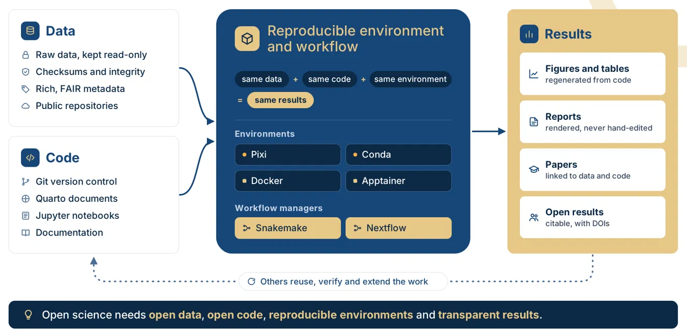

<!-- Styles: "Home page" in assets/css/styles.scss. The title, the line above
it and the "At a glance" card come from event.yml; blocks marked
when-profile show in one format. The previous version is index-backup.qmd. -->

::::::: {.home-hero .column-screen}
:::::: {.home-hero-inner}
:::: {.home-hero-copy}
[]{.home-kicker}

#  {.unnumbered .unlisted}

[Learn how to make computational research reproducible, transparent, and reusable. This hands-on course 
[course]{.content-visible unless-profile="workshop"}[workshop]{.content-visible when-profile="workshop"}
covers project organization, version control, software environments, workflow automation, and open science practices through practical exercises using a real genomics dataset.]
{.home-subtitle}


[Browse the lessons](contents.qmd){.btn .btn-primary}
[Set up your computer](pages/00-setup.qmd){.btn .btn-outline-primary}
::::

:::: {.home-glance}
[At a glance]{.home-glance-label}


::::
::::::
:::::::

:::::: {.home .column-page}

## Three ways to use it

::::: {.home-cards}
:::: {.home-card}
::: {.content-visible when-profile="course"}
###  student
, .

Start with the [7-week schedule](schedule-course.qmd), then
[setup](pages/00-setup.qmd).
:::
::: {.content-visible when-profile="workshop"}
### Workshop participant
.

See the [schedule](schedule-workshop.qmd), and do the
[setup](pages/00-setup.qmd) before day 1.
:::
::: {.content-visible when-profile="self-paced"}
### In a course or workshop
A 7-week course, or a workshop of four or five days.

Follow your instructor's schedule, and do the
[setup](pages/00-setup.qmd) first.
:::
::::
:::: {.home-card}
::: {.content-visible when-profile="course"}
### Workshop participant
The same lessons, condensed.

See the [workshop schedule](schedule-workshop.qmd) and
[setup](pages/00-setup.qmd).
:::
::: {.content-visible when-profile="workshop"}
### After the workshop
Everything stays online.

What the workshop leaves out is self-paced: see the
[schedule](schedule-workshop.qmd) and the [contents](contents.qmd).
:::
::: {.content-visible when-profile="self-paced"}
### Teach it
Run these lessons yourself.

Fork the repository and set the format, dates and people in one
file, `event.yml`: see [Teach these lessons](teach.qmd).
:::
::::
:::: {.home-card}
### On your own
At your own pace.

Do the [setup](pages/00-setup.qmd), then the lessons in the order of the
[contents](contents.qmd).
::::
:::::

## Create research that others can reproduce and build upon

Your analysis worked last month. Can you rerun it today? Can a reviewer, a
labmate, or you in five years? These lessons teach the tools and habits that
make the answer *yes*. You will:

::: {.home-learn}
- **Organize** a project, and keep the raw data untouched
- **Track** every change with Git version control
- **Lock** the software with Pixi, and ship it in containers
- **Report** results with Quarto and Jupyter
- **Automate** the pipeline with Snakemake and Nextflow
- **Share** it with an open license and a DOI via Zenodo
:::

::: {.home-figure}
{fig-alt="Diagram:"}
:::

## One project together, then your own

::::: {.home-cards .home-cards-2}
:::: {.home-card .home-project}
[Guided project]{.home-card-kicker}

### The guided LTEE project

Follow a guided project to build a reproducible genomics analysis using real experimental evolution data.

::: {.content-visible when-profile="course"}
[What to hand in](assessment/ltee-project.qmd){.home-card-link}
:::
::::
:::: {.home-card .home-capstone}
[Your own research]{.home-card-kicker}

### Your capstone project

Apply reproducible practices to your own independent project with data, code, and analysis.

[The capstone](assessment/capstone-rubric.qmd){.home-card-link}
::::
:::::

## What is in every lesson

:::: {.home-steps}
::: {.home-step}
[1]{.home-step-number}

### Slides: the *why*

A short slide deck that gives the background and the motivation.
:::
::: {.home-step}
[2]{.home-step-number}

### Tutorial: the *how*

Self-contained, with copy-and-paste commands, expected output, exercises and
troubleshooting.
:::
::: {.home-step}
[3]{.home-step-number}

### *Break it*

Each lesson ends by breaking something on purpose, so you see what the tool
protects you from.
:::
::::

::::: {.home-footer}
:::: {.home-footer-main}
## Built on open material

This course began as a [mini-course at Stanford Biosciences](https://explorecourses.stanford.edu/search?q=BIOS+259&view=catalog&page=0&filter-coursestatus-Active=on&collapse=&academicYear=20232024)
([BIOS259, Winter 2024](https://github.com/asntech/bios259-w24/)), developed by Aziz Khan and taught with the help of
Alvina, Clemens and Brennan.

The material adapts and extends open lessons from [NBIS](https://nbisweden.github.io/),
[Software Carpentry](https://software-carpentry.org), [Data Carpentry](https://datacarpentry.org/) and many more. See [Sources and credits](pages/credits.qmd).
::::
:::: {.home-footer-side}
### Reuse them

Run them as a course or a workshop, or take single lessons: see
[Teach these lessons](teach.qmd).

Text and slides: [CC BY 4.0](https://creativecommons.org/licenses/by/4.0/).
Code: [MIT](https://opensource.org/license/mit). Developed and maintained by [Aziz Khan](https://github.com/asntech/), [Computational Biology and Cancer Regulatory Genomics (CBCRG)](https://khanlab.bio), MBZUAI.
::::
:::::

::::::
