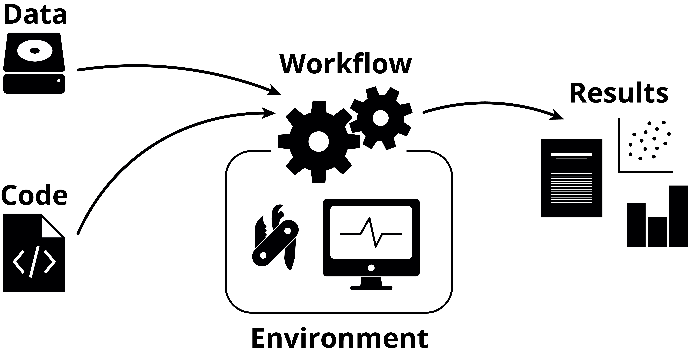

## By the end of this lesson you can

- tell reproducible, replicable, robust and generalizable apart
- name the main causes of irreproducible research, technical and human
- explain the five pillars of computational reproducibility
- judge how a study handles its data, code and environment (decent, good, great)
- argue for open science, and answer the usual concerns
- make your own work more open, starting now

## It starts with a story

::: {.linked-figure}
**Diederik Stapel**, social psychologist: invented data for years; his
fraud was uncovered in 2011 and 58 of his papers were retracted (Retraction
Watch leaderboard). *The original lecture slides showed his portrait and press coverage;
those images are not ours to share.*
:::

. . .

Fraud is rare. Most irreproducible research comes from honest people, under
pressure ("publish or perish"), with messy files, undocumented steps and
software nobody can reinstall.

## How big is the problem?

- **Survey of 1,576 researchers** (Baker 2016): more than 70% had tried
  and failed to reproduce another scientist's experiment; 90% saw a "slight"
  or "significant" crisis
- **Cost** (Freedman et al. 2015): more than half of preclinical research is
  not reproducible, about **US$28 billion a year** in the US alone
- **Psychology** (Open Science Collaboration 2015): 100 studies repeated;
  97% of the originals had significant results, **36%** of the replications;
  effects were half as large
- **Cancer biology** (Errington et al. 2021): planned 193 experiments from 53
  papers; could repeat only **50 experiments from 23 papers**. Median effect
  size **85% smaller**; **46%** of effects (51 of 112) replicated by at least
  three of five criteria. Data to compute effect sizes was public for 4 of 193
  experiments
- **Brazil**: a nationwide multi-lab replication of biomedical methods (Amaral et al. 2019)

## Computational research is no exception

| Study | What was checked | Result |
|-------|------------------|--------|
| Stodden et al. 2018 | 204 papers in *Science* | data and code obtained for 44%, findings reproduced for **26%** |
| Trisovic et al. 2022 | over 9,000 R files on Harvard Dataverse | **74%** failed on the first run, 56% after automatic clean-up |
| Samuel & Mietchen 2024 | 22,578 Python notebooks from biomedical papers | **1,203** ran without errors; 879 gave the published results |

: {tbl-colwidths="[24,36,40]"}

The usual reasons: a missing package, a variable defined somewhere else, a
file expected in a folder that is not there.

## Why it matters {.center}

> Innovation points out paths that are possible; replication points out paths
> that are likely; progress relies on both.

[Open Science Collaboration (2015), *Science* 349:aac4716]{.quote-source}

## Words matter

The Turing Way's 2 × 2 (figure linked, see Sources):

| | Same data | Different data |
|-|-----------|----------------|
| **Same analysis** | **Reproducible** | **Replicable** |
| **Different analysis** | **Robust** | **Generalizable** |

NASEM (2019): *reproducibility* = same data and code, same result;
*replicability* = new data, consistent result. This course is mostly about the
first, which is the minimum: if your own analysis cannot be rerun, nothing
else can be checked.

## A spectrum, not a yes/no

```{.text}
publication only → + code → + code and data → + linked and executable → full replication
   (not reproducible)                                                     (gold standard)
```

After Peng (2011). Every step to the right lets a reader check more.

## Where the research cycle breaks

```{.text}
hypothesis → design → data collection → analysis → interpretation → publication
     ▲   HARKing        low power          p-hacking                    publication bias
     └──────────────────────────────────────────────────────────────────┘
```

Questionable practices at each step (after Munafò et al. 2017, figure 1;
linked in Sources).

## Five selfish reasons (Markowetz 2015)

1. It helps you avoid disaster
2. It makes it easier to write papers
3. It helps reviewers see it your way
4. It enables continuity of your work
5. It helps to build your reputation

## What's in it for you?

:::: {.columns}
::: {.column width="33%"}
**Before** the project

- a clear structure
- scope and limits thought through early
:::
::: {.column width="33%"}
**During**

- rerun everything after a change, in minutes
- easier work with collaborators
- the methods section half writes itself
:::
::: {.column width="33%"}
**After**

- others, and future you, pick it up quickly
- more visible, more reusable work
:::
::::

## When it goes wrong in bioinformatics

**Duke, 2006 to 2011.** Genomic signatures to pick chemotherapy for patients,
used in clinical trials. Baggerly and Coombes tried to reproduce them and
found, among other errors, gene lists shifted by one row and sample labels
swapped. Trials were stopped; papers were retracted.

. . .

**England, October 2020.** Thousands of positive COVID-19 tests were missed
for about a week: results were gathered in Excel's **old `.xls` format, which
holds at most 65,536 rows** per sheet (the current `.xlsx` holds 1,048,576).
Rows beyond the limit were silently dropped.

*(News and journal pages from the original lecture slides are not reproduced; see Sources.)*

## Think, pair, share {.prompt-slide}

::: {.prompt}
**5 minutes.** Share a time when you could not rerun an analysis: yours or
someone else's. What was missing? Who was "to blame": the person, the lab, the
journal, the incentives?
:::

## What affects reproducibility?

| Kind | Examples |
|------|----------|
| Technical | software versions, operating systems, hardware, randomness, lost data |
| Human | undocumented steps, manual edits, file chaos, people leaving |
| Design and statistics | low power, flexible analysis, selective reporting |
| Incentives | novelty over rigor, no credit for data or code |

## Machine learning and AI

- Same code, different GPU or seed: different model
- Data leakage between training and test sets inflates results
- Models and training data often not shared
- Generative AI in research and review: new questions about what is disclosed and checked

AI is also a tool *for* reproducibility: explaining code, writing tests and
documentation. Check what it writes.

## Every analysis has the same parts

{fig-alt="Diagram: data and code go into a workflow that runs in a software environment and produces results such as reports and figures." width="72%" fig-align="center"}

[Figure: NBIS, *Tools for Reproducible Research*, CC BY 4.0]{.fig-credit}

[Data (lesson 03) · code (04, 06, 07) · environment (05, 08) · workflow (09, 10) · shared results (11, 12)]{.small .muted}

## How are you handling your data?

::: {.fragment}
**Decent:** available on request; all metadata needed for the results available
:::

::: {.fragment}
**Good:** raw data in a public repository; any preprocessing done by scripts,
never by hand
:::

::: {.fragment}
**Great:** a section or repository that helps others reproduce it; open,
machine-readable formats (`.csv`, not `.xls`)
:::

## How are you handling your code?

::: {.fragment}
**Decent:** the code from processed data to results is available on request
:::

::: {.fragment}
**Good:** all code from raw data to results is public, with versions (tags,
releases)
:::

::: {.fragment}
**Great:** documented, with instructions to reproduce the results; seeds
recorded for random methods
:::

## How are you handling your environment?

::: {.fragment}
**Decent:** the key programs are named in the methods
:::

::: {.fragment}
**Good:** every program is listed, **with its version**
:::

::: {.fragment}
**Great:** files or instructions that rebuild the whole environment (a lock
file, a container)
:::

::: {.fragment}
[Tutorial 01 turns these levels into an audit of a published paper.]{.muted}
:::

## The five pillars (Ziemann et al. 2023)

1. **Literate programming**: code and text together (Quarto, Jupyter)
2. **Code version control and sharing**: Git, GitHub
3. **Compute environment control**: Pixi, containers
4. **Persistent data sharing**: repositories, identifiers, checksums
5. **Documentation**: README, citation, licenses

The rest of this course is one lesson per pillar, on one example project.

## When should you worry about reproducibility?

. . .

**All the time.** It is cheapest on day one and most expensive the week
before submission.

## Open science

- **Open access** to papers
- **Open data**, FAIR and CARE (lesson 03)
- **Open source** code
- **Open methods**: protocols, preregistration
- **Open peer review** and open educational resources (like this course)

## Why open?

- Others can check, reuse and build on your work
- Shared data is cited more: in one study of 85 cancer microarray trials,
  publicly available data was associated with **69% more citations**
  (Piwowar et al. 2007)
- Funders and journals increasingly require it

## Concerns, and answers

| Concern | Answer |
|---------|--------|
| "I will be scooped" | A DOI and a public date establish priority; preprints help |
| "Nobody credits data and code" | Cite them (CITATION.cff, DOIs); they count increasingly |
| "Patient privacy" | Controlled access for sensitive data; share code and metadata (lesson 03) |
| "It is extra work" | Less work than redoing an analysis you cannot rerun |
| "It hurts my career" | Open work is easier to find, evaluate and reuse |

## Think, pair, share {.prompt-slide}

::: {.prompt}
**3 minutes.** Human genomic data: what could you share openly from a study of
200 patients? What only under controlled access? (We return to this in lesson 03.)
:::

## Quiz {.quiz-slide}

::: {.quiz}
1. Same data, same code, same result: is that reproducible or replicable?
2. In the Cancer Biology project, how many of the 193 planned experiments were repeated? (a) 193 (b) 120 (c) 50
3. Which is **not** one of the five pillars? (a) literate programming (b) environment control (c) peer review (d) documentation
:::

::: {.notes}
Answers: 1 reproducible; 2 c (from 23 papers); 3 c.
:::

## Recap

- Reproducible ≠ replicable; reproducibility is the minimum
- Most failures are honest: files, steps and software nobody can recover
- Five pillars: literate programming, version control, environments, data sharing, documentation
- Open science helps others and you; FAIR is not the same as open

**Self-paced:** [tutorial 01](../../pages/01-introduction.qmd), audit a paper's data and code.

**Full lecture slides (PDF):** [Lecture 1, Reproducibility](../../slides/Lecture1_Reproducibility.pdf) and [Lecture 2, Open science](../../slides/Lecture2_Open-Science.pdf).
