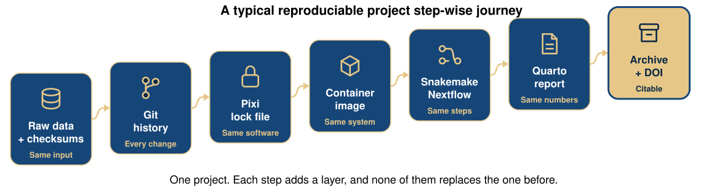
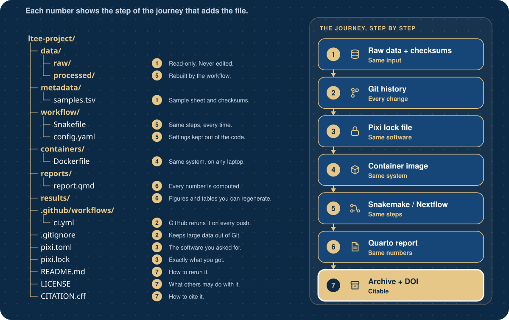
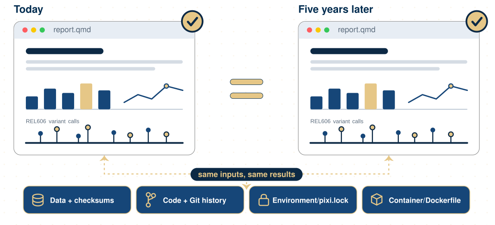

## Today you will

- design a project layout on paper, then generate one from a template
- keep raw data read-only and make results rebuildable
- name files so people and programs can read them
- use relative paths so the project runs on any computer

::: {.notes}
Week 1 covered this in slides 44 to 52. Today is hands-on: about 15 minutes of
slides, then the tutorial (lesson 02) and the lesson 03 data hands-on.
:::

## Which file is the latest?

```{.text}
$ ls -l results/
-rw-r--r--  ada  Oct 12 22:00  variants.xlsx
-rw-r--r--  ada  Oct 16 11:39  variants_final.xlsx
-rw-r--r--  ada  Oct 18 22:41  variants_final_v2.xlsx
-rw-r--r--  ada  Oct 18 13:25  variants_USE_THIS.xlsx
-rw-r--r--  ada  Oct 15 22:39  variants_v2_ADA.xlsx
```

. . .

And which script and which input made it?

## Who reads your project?

- **You, in six months**: you will not remember
- **A labmate** who takes over the analysis
- **A reviewer** who wants to rerun one figure
- **A program** (CI, a workflow manager) that needs predictable paths

Organization is not one of the five pillars of reproducibility (literate
programming, version control, environments, data sharing, documentation),
but every pillar is easier when files are where everyone expects them.

## Think, pair, share {.prompt-slide}

::: {.prompt}
**5 minutes, on paper.** You will analyze 6 FASTQ files (3 samples), a
reference genome and a sample table, with scripts, a pipeline, a report and
a software environment.

1. Draw your folders. Put every item in one.
2. Mark what you would **never edit** and what you could **delete and rebuild**.
3. Compare with your neighbor: where do you disagree?
:::

## Two published answers

:::: {.columns}
::: {.column width="50%"}
**Noble 2009**

```{.text}
project/
  doc/
  data/
  src/
  bin/
  results/
    2009-01-15/
    2009-01-23/
```
:::
::: {.column width="50%"}
**Wilson et al. 2017**

```{.text}
project/
  README  LICENSE  CITATION
  requirements.txt
  data/
  doc/
  results/
  src/
```
:::
::::

Both: one folder per project, raw data untouched, results made by code.

## A third answer: shaped by the workflow

:::: {.columns}
::: {.column width="45%"}
```{.text}
config/
  config.yaml
profiles/
workflow/
  Snakefile
  rules/
  envs/
  scripts/
  schemas/
LICENSE  README.md
```
:::
::: {.column width="55%"}
The [Snakemake workflow template](https://github.com/snakemake-workflows/snakemake-workflow-template):
settings in `config/`, everything that runs in `workflow/`.

Our template borrows `config/` and `workflow/` from it, so the LTEE project
can grow a workflow in lesson 09 without moving files.
:::
::::

## The one rule

```{.text}
data/raw/ ──code──► data/processed/ ──code──► results/ ──► reports/
read-only           rebuildable                rebuildable
downloaded          not in Git                 not in Git
```

If you delete `data/processed/` and `results/`, **one command** must bring
them back. That command is the test of your organization.

## Treasure your data

- Keep raw data **read-only**, exactly as downloaded
- Never save a second, "cleaned" copy by hand: write the cleaning as a
  **script** (or a notebook, a report, a workflow step), so it can be redone
- **Back up**: copies in more than one physical place
- Deposit raw data in a **public repository** as early as you can

## Organize your code

- Do nothing **by hand** that a program could do: no copy-paste between
  files, no clicking through a spreadsheet
- Connect raw data to results with **code**: scripts, Quarto, Jupyter,
  Snakemake, Nextflow
- Keep **settings apart from code**: at the top of a script, or better in
  `config/config.yaml`

## A typical reproducible project step-wise journey

{fig-alt="Diagram: A typical reproducible project step-wise journey" width="100%"}

## What the project folder looks like at the end

{fig-alt="Diagram: What the project folder looks like at the end" width="100%"}


## Our template

::: {.code-tight}
```{.text}
ltee-project/
├── README.md
├── LICENSE
├── CITATION.cff
├── data/
│   ├── raw/
│   └── processed/
├── metadata/
├── scripts/
├── config/
├── workflow/
├── containers/
├── notebooks/
├── reports/
├── results/
├── docs/
├── envs/
└── .github/workflows/reproduce.yml
```
:::

One command creates it:

```{.bash}
pixi exec --spec cookiecutter --spec git -- \
  cookiecutter gh:khan-lab/cbio7501-f26 --directory templates/cookiecutter-repro-project
```


## Why sketch first?

- A template is someone else's decisions, frozen
- If you never made the decisions, you cannot defend or change them
- Sketch → compare with the literature → generate → discuss each difference

## Can you reproduce your analysis in 5 years

{fig-alt="Diagram: Can you reproduce your analysis in 5 years" width="100%"}

## Names that sort and explain

| Instead of | Write |
|------------|-------|
| `final results (use this).xlsx` | `variant-counts.csv` |
| `12-10-2026 run.bam` | `SRR2584863.aligned.sorted.bam` |
| `sample1 … sample10 … sample2` | `s01 … s02 … s10` |
| `results 5Aug.txt` | `qc-summary_2026-08-05.txt` |

No spaces · ISO dates · leading zeros · same parts in the same order

## Relative, not absolute

```{.python}
open("/Users/ada/Desktop/ltee/metadata/samples.tsv")   # works only for Ada
open("metadata/samples.tsv")                           # works for everyone
```

Run every command from the project folder. The tutorial's *Break it* exercise
shows the absolute path failing.

## Tools that help

:::: {.columns}
::: {.column width="50%"}
**On your laptop**

- [VS Code](https://code.visualstudio.com/): editor, terminal, Git, Jupyter
- [RStudio](https://posit.co/products/open-source/rstudio/) or [Positron](https://positron.posit.co/) for R and Python
- [PyCharm](https://www.jetbrains.com/pycharm/)
:::
::: {.column width="50%"}
**On a cluster, over SSH**

- [VS Code Remote SSH](https://code.visualstudio.com/docs/remote/ssh)
- `nano` (easy) or `vim` (powerful)
:::
::::

Pick one editor and learn it well; it should show the whole project folder.

## Quiz {.quiz-slide}

::: {.quiz}
1. Where does the downloaded reference genome go?
   (a) `results/` (b) `data/raw/` (c) `scripts/` (d) `data/processed/`

2. You found a wrong sample label in a raw FASTQ header. What do you do?
   (a) edit the FASTQ (b) fix it in code and write to `data/processed/`
   (c) rename the file by hand (d) email the data provider and wait

3. Which name sorts correctly in time? (a) `5-Aug-2026` (b) `2026-8-5` (c) `2026-08-05`
:::

::: {.notes}
Answers: 1 b; 2 b (and tell the provider, d, as well); 3 c.
:::

## Recap

- Same layout in every project; decide it before the first file arrives
- Raw data read-only and downloaded by code; everything else rebuildable
- A template saves time; know why each folder exists
- Good names sort and explain; relative paths travel

**Now:** [tutorial 02](../../pages/02-project-organization.qmd), then the
[lesson 03 hands-on](../../pages/03-data-management.qmd#hands-on).
