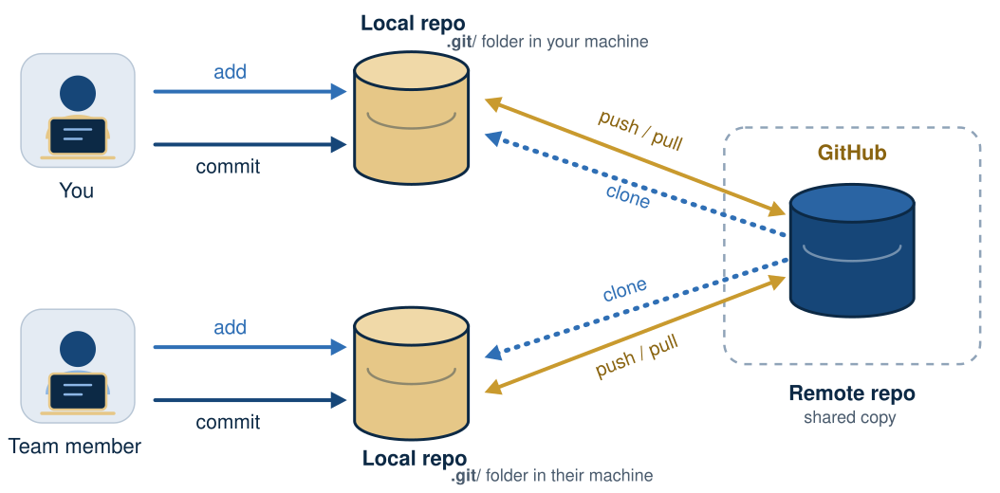

## Today you will

- record every change to the LTEE project, with who, when and why
- get deleted work back
- try ideas on branches and merge them, conflicts included
- share the project on GitHub and let GitHub rerun it

## Why version control?

- `analysis_final_v2_REALLY_FINAL.py`: history by file name
- A laptop that is lost or stolen takes the only copy with it
- "Which code made Figure 3?" has no answer


## Git is a version control system

- **Git** is an open-source, distributed version control system created by *Linus Torvalds* in 2005

- **Git** keeps a **complete history** of the project/code: like a shared drive that
keeps versions, except that **you** decide when a version is saved, and why.
- **GitHub** keeps a **copy** and adds review and automation.

*Note*: Git is made for **text** (code, config, Markdown), not for large or binary
data files.

## Terms you need to know

| Word | Meaning |
|------|---------|
| repository | the project folder plus its history (`.git/`) |
| commit | a snapshot, with a message, an author and an ID |
| branch | a separate line of work |
| remote | another copy of the repository, e.g. on GitHub (`origin`) |
| push / pull | send commits to / get commits from a remote |
| pull request | a proposal to merge a branch, with review and checks |

{fig-alt="" width="70%" fig-align="center"}
[Figure: By *Aziz Khan*, CC BY 4.0]{.fig-credit}

## Three steps, over and over

{fig-alt="Diagram: working copy, then 'stage changes' to the staging area, then 'commit changes' to the Git repository." width="62%" fig-align="center"}

[Figure: By *Aziz Khan*, CC BY 4.0]{.fig-credit}

1. **Edit** files: `git status` shows what changed in the working directory
2. **Stage** what belongs together: `git add FILE`
3. **Commit** it to the history: `git commit -m "Why this change"` 

## Working with a remote

:::: {.columns}
::: {.column width="55%"}
{fig-alt="Diagram: a remote repository in the cloud; local repository A clones, pulls, fetches and pushes; a second local copy B does the same." width="100%"}

[Figure: By *Aziz Khan*, CC BY 4.0]{.fig-credit}
:::
::: {.column width="45%"}
- `git clone`: your own full copy, history included
- `git push`: send your commits to GitHub
- `git pull`: get the others' commits (`fetch` + merge)
- Every copy (yours, your labmate's, GitHub's) has the whole history
:::
::::

## What goes into Git?

| Commit | Do not commit |
|--------|---------------|
| scripts, workflows, config | raw data (download it: `scripts/download_data.py`) |
| `pixi.toml`, `pixi.lock` | `.pixi/` (rebuilt from the lock file) |
| report and notebook **sources** | rendered HTML, notebook outputs |
| metadata, checksums, README | results (rebuilt by `pixi run reproduce`) |

`.gitignore` makes this automatic.

```{.text}
.pixi/*
!.pixi/config.toml

data/raw/**
!data/raw/README.md
.
.
```
## Branches and pull requests

```{.text}
main          ●───●───────────●   (merge)
                   \         /
lesson-04-readme    ●───●───●     push → pull request → review + checks → merge
```

From now on: **one branch and one pull request per lesson.**

{#fig-git-branches fig-alt="Two branches leave main, one above and one below. Each gains commits while main stays still, then merges back."}


## A check on every push

The template's GitHub Action runs on every push and pull request: a fresh
Linux machine, a clean clone of your repository, then `pixi run reproduce`.

- For now `reproduce` is a placeholder: the check is green but proves little
- Lesson 05 makes it download the data and run the pipeline
- From then on, a green check means: *it rebuilds on a computer that has
  never seen it*

## Git is versatile

- **Reproducibility**: tag the commit that made the paper's figures; it stays
  rerunnable however much the code changes afterwards
- **Mistakes**: any committed version can come back
- **Structure**: small commits with reasons make you think in steps
- **Backup**: the copy on GitHub survives your laptop
- **Sharing**: collaborators work on the same history, not on emailed files

## Think, pair, share {.prompt-slide}

::: {.prompt}
**3 minutes.** Your labmate leaves. You inherit a folder with 40 scripts and
no history. Which three questions can you not answer? Which of them would Git
have answered?
:::

## Quiz {.quiz-slide}

::: {.quiz}
1. Which file should **not** be committed? (a) `pixi.lock` (b) `data/raw/SRR2584863_1.trim.sub.fastq` (c) `scripts/download_data.py`
2. You deleted a file and committed the deletion. Can Git restore it? (yes / no)
3. Two branches change the same line. What does `git merge` do? (a) keeps the newest (b) stops with a conflict for you to resolve (c) keeps both lines
:::

::: {.notes}
Answers: 1 b; 2 yes (git restore --source=HASH~1 FILE); 3 b.
:::

## Recap

- Commit small, related changes with clear messages; push often
- Commit what people write; ignore what programs rebuild
- Committed work can always be recovered
- Branch, pull request, green check, merge

**Now:** [tutorial 04](../../pages/04-git.qmd).
