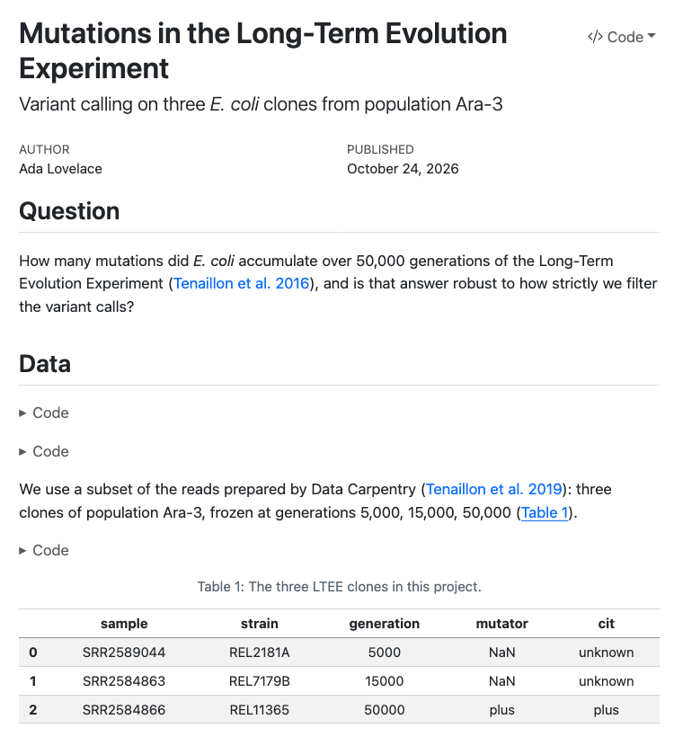

## Today you will

- turn the LTEE data into a report that rebuilds itself
- compute every number, table and figure when the report renders
- change a report with parameters and formats, not edits

## The copy-paste problem

```{.text}
analysis.py ──► results.csv ──► (copy) ──► Figure 2 in report.docx
                                  ▲
            data changes ─────────┘   the report does not notice
```

. . .

Which version of the data made Figure 2? Nobody knows.

## Literate programming

> "Let us concentrate rather on explaining to human beings what we want a
> computer to do." --- Donald Knuth, 1984

- Text **and** code in one document
- The document is **rendered** by running the code
- The output is always in sync with the code and the data

## Quarto connects code with results

{fig-alt="Diagram: data and code go into a workflow that runs in a software environment and produces results such as reports and figures." width="62%" fig-align="center"}

[Figure: NBIS, *Tools for Reproducible Research*, CC BY 4.0]{.fig-credit}

A Quarto document holds the **code** and the **text** about its **results**,
and makes the results by running the code.

## Quarto in one picture

```{.text}
ltee-report.qmd ──quarto render──► runs Python ──► ltee-report.html
  text (Markdown)                   (fresh session,   ltee-report.pdf
  code cells                         top to bottom)   slides, Word, websites
  settings (YAML)
```

This website and these slides are Quarto documents too.

## What a cell looks like

````{.markdown}
```{{python}}
#| label: tbl-samples
#| tbl-cap: "The three LTEE clones in this project."
samples = pd.read_csv("metadata/samples.tsv", sep="\t")
samples[["sample", "strain", "generation"]]
```

Clones were frozen at generations `{python} ", ".join(map(str, samples["generation"]))`
(@tbl-samples).
````

Cell options (`#|`) · numbered, cross-referenced tables and figures · inline values

## Source and result

:::: {.columns}
::: {.column width="52%"}
````{.markdown}
---
title: "Mutations in the LTEE"
author: "Ada Lovelace"
format:
  html:
    code-fold: true
---

## Question

How many mutations did *E. coli*
accumulate over 50,000 generations?
````

::: {.small}
- **YAML header**: title, format, options
- **Markdown** text
- **Code cells**: run when you render
:::
:::
::: {.column width="48%"}
{.bordered fig-alt="The rendered LTEE report: title, author, date, the question, a table of the three clones, and folded code cells." height="470px"}
:::
::::

## One command, many outputs

```{.bash}
pixi run quarto render reports/ltee-report.qmd                    # HTML
pixi run quarto render reports/ltee-report.qmd --to typst         # PDF
pixi run quarto render reports/ltee-report.qmd -P max_reads:2000  # other parameter
```

## Rendering

```{.bash}
quarto render report.qmd              # the formats listed in the header
quarto render report.qmd --to pdf     # one specific format
quarto preview report.qmd             # re-render on every save
```

In this course: `pixi run quarto render ...`, so the report uses the
project's Python. VS Code, Positron and RStudio also have a **Render** button.

## Output formats

- **Documents**: HTML, PDF (Typst or LaTeX), Word, Jupyter notebooks
- **Presentations**: reveal.js (these slides), PowerPoint, Beamer
- **Websites, books and blogs** (this course site)
- **Journal articles**, with journal templates
- **Interactive** documents (Observable JS, Shiny)
- Your own **custom formats**

## Quarto and R Markdown

- Quarto is a **command-line tool**; R Markdown is an R package
- Quarto works the same with **Python, R, Julia** and Observable JS
- Everything is built in: slides, websites and books need no extra packages
- Quarto renders most R Markdown (`.Rmd`) files as they are
- R Markdown is still maintained, but new features go into Quarto

## Think, pair, share {.prompt-slide}

::: {.prompt}
**3 minutes.** Look at the last paper you read or wrote.

- Which numbers in the text were typed by hand?
- If the data changed tomorrow, which would be wrong?
:::

## Quiz {.quiz-slide}

::: {.quiz}
1. You defined `samples` in your Python console. Your report uses `samples` but never defines it. What happens on render?
   (a) it works (b) `NameError`, the render fails (c) Quarto asks for the value

2. Where should a number like "175,000 read pairs" in your report come from?
   (a) typed from the terminal output (b) an inline `{python}` expression (c) a comment
:::

::: {.notes}
Answers: 1 b (each render is a fresh session); 2 b.
:::

## Recap

- Literate programming: text and code in one document, rendered together
- Quarto runs the cells in a fresh session, top to bottom
- Never type a result: compute it inline
- Parameters and formats change the output, not the source

**Now:** [tutorial 07](../../pages/07-quarto.qmd).
