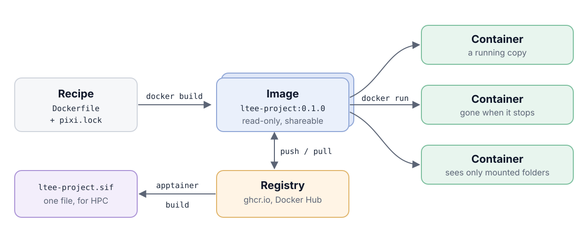
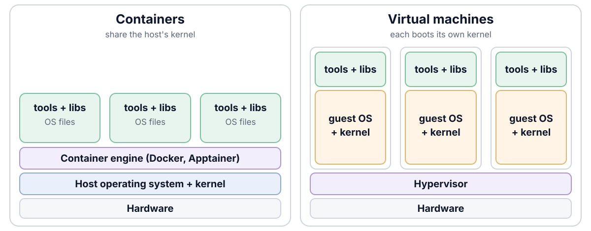

## Today you will

- run tools inside containers, with your project mounted
- build an image of the LTEE environment **from `pixi.lock`**
- get the same variant calls on another operating system
- record which image made a result

## Containers in life science

- **CAMI**, a community benchmark of metagenomics tools, asked every
  participant to submit the tool **as a Docker container**, with its
  parameters and databases, so the organizers could rerun it
  (Sczyrba et al. 2017)
- The second round accepted a container, a Bioconda recipe, or a repository
  with installation instructions (Meyer et al. 2022)

A container is a way to hand someone **the whole working setup**, not just
the code.

## What the lock file cannot pin

```{.text}
your analysis        ← Git (lesson 04)
Python, samtools …   ← pixi.lock (lesson 05)
C library, OS tools  ← ???      ← a container pins this too
kernel, hardware     ← nobody
```

## Image and container

{fig-alt="Diagram: a Dockerfile and pixi.lock are built into an image with docker build; docker run starts containers from it; images are pushed to and pulled from a registry; apptainer build turns an image into a .sif file for HPC." width="88%" fig-align="center"}

- **Image**: software plus a minimal operating system, read-only;
  **container**: a running copy of it
- **Tag** (`:0.1.0`) can move; **digest** (`@sha256:…`) cannot

## Another operating system, one command away

```{.bash}
$ uname -sm                                  # your Mac
Darwin arm64

$ docker run --rm ubuntu:24.04 uname -sm     # a Linux container on it
Linux aarch64
```

The container brings its own operating system files; it borrows only the
kernel of the computer it runs on (on a Mac, a small Linux virtual machine).

## Containers vs virtual machines

{fig-alt="Diagram: on the left, three containers with tools, libraries and OS files run on one container engine on the host operating system and kernel. On the right, three virtual machines each carry tools, libraries and a full guest operating system with its own kernel, on a hypervisor." width="80%" fig-align="center"}

- **Container**: shares the host's kernel; starts in seconds, as big as its software
- **Virtual machine**: boots its own operating system; heavier and slower, but fully separate

## A container sees only what you mount

:::: {.columns}
::: {.column width="50%"}
```{.bash}
$ docker run --rm ltee-project:0.1.0 \
    ls scripts
ls: cannot access 'scripts':
  No such file or directory
```
:::
::: {.column width="50%"}
```{.bash}
$ docker run --rm \
    -v "$PWD":/work -w /work \
    ltee-project:0.1.0 ls scripts
README.md
compare_vcfs.py
download_data.py
fastq_stats.py
run_variant_calling.sh
```
:::
::::

`-v "$PWD":/work` puts your project folder at `/work` inside the container;
`-w /work` starts there. Results written to `/work` land in your project.

## Commands you will use today

:::: {.columns}
::: {.column width="56%"}
```{.bash}
docker build -t NAME:TAG .   # Dockerfile → image
docker images                # list images
docker run --rm IMAGE CMD    # image → container
docker ps -a                 # list containers
docker pull IMAGE            # from a registry
docker push IMAGE            # to a registry
docker rmi IMAGE             # delete an image
```
:::
::: {.column width="44%"}
| Flag | Means |
|------|-------|
| `--rm` | delete the container when it exits |
| `-v "$PWD":/work` | mount your project |
| `-w /work` | start in that folder |
| `-it` | interactive shell |
| `--platform linux/amd64` | build for Intel/AMD Linux |
:::
::::

Any command: `docker <command> --help`. All of it on one page: the
[Docker cheat sheet](../../cheatsheets/docker.qmd).

## Docker or Apptainer?

| | Docker | Apptainer |
|-|--------|-----------|
| Where | laptops, GitHub Actions | HPC clusters (Linux only) |
| Needs root? | a root service | no |
| Your files | mount with `-v "$PWD":/work` | home and current folder mounted automatically |
| Same image? | builds it | converts it: `apptainer build x.sif docker://…` |
| Images | stored by the Docker service | single `.sif` files you can copy |
| Isolation | separate file system by default | sees much of the host's |
| Runs on | Linux, macOS, Windows | Linux (macOS and Windows only in a VM) |

: {tbl-colwidths="[18,38,44]"}

::: {.small .muted}
Singularity became Apptainer under the Linux Foundation in 2021. Sylabs' fork,
SingularityCE, released 4.6.0 in October 2026 and says it is expected to be
its final release. Apptainer still runs the `singularity` command and SIF
images.
:::

## What should go in a container?

1. **The environment**: tools and libraries. Yes: this is what containers
   are best at
2. Your code **with** the environment: possible, but now every code change
   needs a new image
3. The **whole project**, data included: hard to update, hard to inspect

. . .

Best overall: a **Git repository** with code, documentation, the environment
files (`pixi.toml`, `pixi.lock`, `Dockerfile`) and instructions to download the
data; the image is built from it, and archived with each release.

## Dockerfile instructions

| Instruction | What it does | Takes effect |
|-------------|--------------|--------------|
| `FROM` | start from an existing image | build |
| `COPY` | copy files from your project into the image | build |
| `RUN` | run a command, for example install software | build |
| `WORKDIR` | set the working folder | build, and where containers start |
| `ENV` | set an environment variable | build, and in containers |
| `ENTRYPOINT` / `CMD` | what runs when a container starts | container start |

: {tbl-colwidths="[24,46,30]"}

`RUN` and `COPY` each add a **layer**, and Docker reuses unchanged layers.
That is why our Dockerfile copies `pixi.toml` and `pixi.lock` first: the slow
install is redone only when they change.

## The Dockerfile, in three ideas

```{.dockerfile}
FROM ghcr.io/prefix-dev/pixi:0.83.0 AS build          # 1. Pixi's image
COPY pixi.toml pixi.lock ./
RUN pixi install --locked --environment pipeline      #    exactly the lock file

FROM ubuntu:24.04 AS production                        # 2. small final image
COPY --from=build /opt/project/.pixi/envs/pipeline /opt/project/.pixi/envs/pipeline
ENTRYPOINT ["/entrypoint.sh"]                          # 3. activate, then run
```

Container and laptop **cannot drift**: both come from `pixi.lock`.

## Peer instruction {.prompt-slide}

::: {.prompt}
**Vote, discuss with your neighbour, vote again.** What is the difference
between `RUN` and `CMD` in a Dockerfile?

(a) There is no difference\
(b) `CMD` runs when the image is built; `RUN` when a container starts\
(c) `RUN` runs when the image is built; `CMD` when a container starts\
(d) No difference, unless the container is started interactively
:::

::: {.notes}
Answer: c. One minute to vote alone, two minutes to discuss, then vote again.
The usual confusion: `RUN` sounds like `docker run`. Point at our Dockerfile:
`RUN pixi install --locked` happens once, at build; `ENTRYPOINT` (like `CMD`)
happens every time a container starts.
:::

## Run the pipeline in it

```{.bash}
docker build --platform linux/amd64 -f containers/Dockerfile \
  --build-arg ENV_NAME=pipeline -t ltee-project:0.1.0 .

docker run --rm -v "$PWD":/work -w /work ltee-project:0.1.0 \
  bash scripts/run_variant_calling.sh
```

10, 25 and 775 variants: the same as on your laptop.

## On the cluster: Apptainer

Docker needs a root service, so shared clusters do not offer it. Apptainer
runs the **same image** without root:

```{.bash}
# turn the image into one file (docker:// pulls from a registry,
# docker-daemon:// takes your local Docker image)
apptainer build ltee-project.sif \
  docker://ghcr.io/ada-lovelace/ltee-project:0.1.0

# home and current folder are mounted for you: no -v
apptainer exec ltee-project.sif samtools --version
apptainer run  ltee-project.sif bash scripts/run_variant_calling.sh
```

`run` starts the image's start script; `exec` runs a command directly.

## Share and archive the image

:::: {.columns}
::: {.column width="50%"}
**To share: a registry**

```{.bash}
docker tag ltee-project:0.1.0 \
  ghcr.io/ada-lovelace/ltee-project:0.1.0
docker push \
  ghcr.io/ada-lovelace/ltee-project:0.1.0
```
:::
::: {.column width="50%"}
**To archive: a file**

```{.bash}
docker save ltee-project:0.1.0 \
  | gzip > ltee-project_0.1.0.tar.gz
# upload with the release to Zenodo
docker load -i ltee-project_0.1.0.tar.gz
```
:::
::::

Registries change their rules and delete old images; a file archived with a
DOI stays.

## Pros and cons of containers

:::: {.columns}
::: {.column width="50%"}
**Pros**

- Move a workflow between laptop, CI and cluster unchanged
- Much lighter than virtual machines
- Works on any machine with a container engine, not only yours
- For software with many dependencies, the most reliable way to keep it
  runnable for years
:::
::: {.column width="50%"}
**Cons**

- Images can contain security vulnerabilities
- Can hide installation problems instead of fixing them
- Not always clear what belongs in the recipe and what in the image
:::
::::

## Think, pair, share {.prompt-slide}

::: {.prompt}
**3 minutes.** A paper gives a Docker Hub image name `lab/tool:latest` as its
"reproducible environment". What could go wrong in two years? What would you
ask the authors to add?
:::

::: {.notes}
Tag moved or image deleted; no Dockerfile or recipe; no digest; image built
with unpinned apt-get. Ask for: the Dockerfile and lock file in the repository,
a digest, and an archived image file (Zenodo).
:::

## Quiz {.quiz-slide}

::: {.quiz}
1. `docker run ltee-project:0.1.0 bash scripts/run_variant_calling.sh` says "No such file". Why? (a) image broken (b) project not mounted (c) wrong tag
2. Which pins an image exactly? (a) `:latest` (b) `:0.1.0` (c) `@sha256:…`
3. Where do you use Apptainer instead of Docker? (a) on a Mac (b) on an HPC cluster (c) in Word
4. Which order is right? (a) Dockerfile → container → image (b) image → container → Dockerfile (c) Dockerfile → image → container
:::

::: {.notes}
Answers: 1 b; 2 c; 3 b; 4 c.
:::

## Recap

- Images pin software and the OS layer; containers run them
- Build images from `pixi.lock`; mount your project with `-v`
- Record digests and archive the image with a release
- Docker on laptops and CI; Apptainer on clusters
- More: [Docker docs](https://docs.docker.com/),
  [Dockerfile reference](https://docs.docker.com/reference/dockerfile/),
  [Apptainer docs](https://apptainer.org/docs/user/latest/)

**Now:** [tutorial 08](../../pages/08-containers.qmd).
