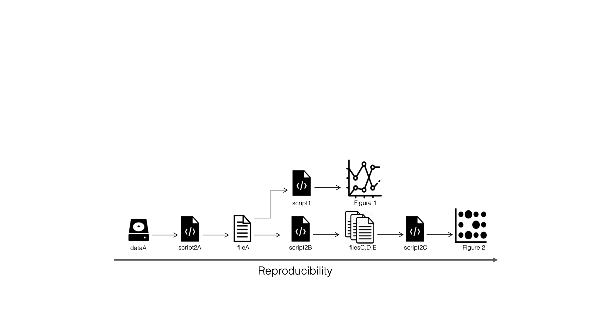
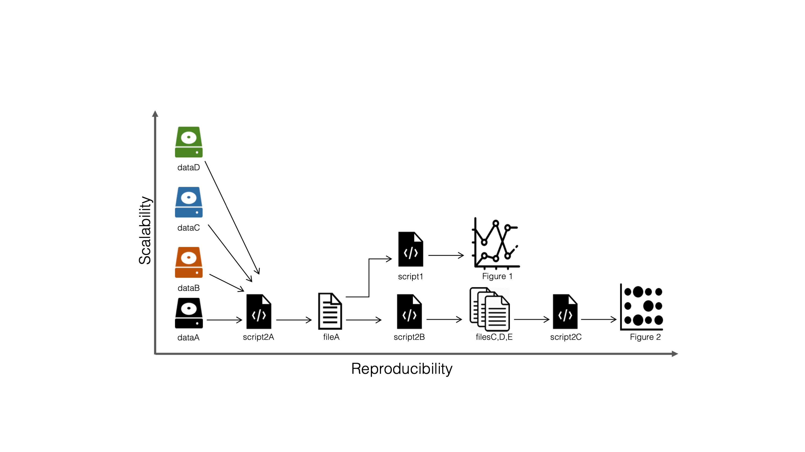
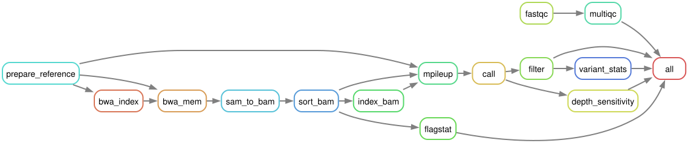

## Today you will

- describe the LTEE pipeline as rules from inputs to outputs
- let Snakemake decide what to run, in which order, and what is out of date
- move samples and settings out of the code
- show that the workflow reproduces the shell script exactly

## What a shell script cannot do

```{.bash}
for sample in ...; do
    bwa mem ...          # 1 minute
    samtools ...
    bcftools ...
    vcfutils.pl varFilter -d 2 ...   # change to 10?
done
```

- Change the last step → **everything** reruns
- A step fails on sample 3 → start again
- New sample → edit the loop
- One sample at a time, even on 16 cores

## Why workflow managers?

As a project grows, or just ages, it gets hard to remember which step made
which file, from what, with which settings.

A workflow manager keeps track for you, and lets you scale up in
**complexity** (more steps) and in **size** (more samples).

## Reproducible...

{fig-alt="Diagram: dataA goes through script2A to fileA, which feeds script1 to Figure 1 and script2B to files C, D and E, then script2C to Figure 2; an arrow along the bottom is labeled Reproducibility." width="88%" fig-align="center"}

[Figure: NBIS, *Tools for Reproducible Research*, CC BY 4.0]{.fig-credit}

## ...and scalable

{fig-alt="The same diagram with three more datasets, B, C and D, entering the same first script; a vertical axis is labeled Scalability." width="88%" fig-align="center"}

[Figure: NBIS, *Tools for Reproducible Research*, CC BY 4.0]{.fig-credit}

## Workflow managers in bioinformatics

:::: {.columns}
::: {.column width="50%"}
**Most used**

- **Snakemake**: Python-like rules, built on file names (this lesson)
- **Nextflow**: Groovy, processes connected by channels (lesson 10)
:::
::: {.column width="50%"}
**Also around**

- **Make**: the original, since 1976
- **CWL** and **WDL**: standard workflow languages
- **Galaxy**: workflows in a web interface
:::
::::

## The Snakemake mindset

From the Snakemake documentation:

> A Snakemake workflow is defined by specifying rules in a Snakefile.

> Rules decompose the workflow into small steps.

> Snakemake automatically determines the dependencies between the rules by
> matching file names.

## Rules connect through file names

```{.python}
rule sort_bam:
    input:  "results/bam/{sample}.aligned.bam"
    output: "results/bam/{sample}.aligned.sorted.bam"
    shell:  "samtools sort -o {output} {input}"
```

Ask for `results/vcf/SRR2584866_final_variants.vcf`: Snakemake finds the rules
whose outputs match, all the way back to the raw reads.

## Targets: what you ask for

- Rules only say what **can** be made
- The files you **want** (the targets) decide which rules run
- Without a target, Snakemake builds the default rule, by convention `all`:

```{.python}
rule all:
    default_target: True
    input:
        "results/qc/multiqc/multiqc_report.html",
        expand("results/vcf/{sample}_final_variants.vcf", sample=SAMPLES),
        ...
```

## The job graph

{fig-alt="Rule graph of the LTEE workflow, left to right: prepare_reference, bwa_index, bwa_mem, sam_to_bam, sort_bam, index_bam, mpileup, call, filter and variant_stats in a chain, with flagstat, depth_sensitivity, fastqc and multiqc branching off, all feeding the rule all." width="100%"}

:::: {.columns}
::: {.column width="55%"}
```{.bash}
pixi run -e pipeline snakemake \
  --rulegraph > results/rulegraph.dot
pixi run -e pipeline dot -Tsvg \
  results/rulegraph.dot -o results/rulegraph.svg
```
:::
::: {.column width="45%"}
- Independent jobs run **in parallel**
- Only **missing or outdated** outputs are rebuilt
:::
::::

## Anatomy of a rule

:::: {.columns}
::: {.column width="58%"}
```{.python}
rule bwa_mem:
    input:
        genome=GENOME,
        index=rules.bwa_index.output,
        r1=lambda wc: SAMPLES[wc.sample]["fastq_1"],
        r2=lambda wc: SAMPLES[wc.sample]["fastq_2"],
    output:
        temp("results/sam/{sample}.aligned.sam"),
    log:
        "results/logs/bwa_mem/{sample}.log",
    threads: 4
    params:
        extra=config["bwa_extra"] or "",
    shell:
        "bwa mem -t {threads} {params.extra} "
        "{input.genome} {input.r1} {input.r2} "
        "> {output} 2> {log}"
```
:::
::: {.column width="42%"}
::: {.small}
- **input**, **output**: files, with a `{sample}` wildcard
- `temp()`: deleted once no longer needed
- **log**: a paper trail for every job
- **threads**, `resources:`: what a job may use
- **params**: settings, here from the config file
- **shell**: the command, filled in from the rest
:::
:::
::::

## Software for each rule

We run every rule in one Pixi environment. Snakemake can also give each rule
its own:

```{.python}
rule fastqc:
    conda: "envs/fastqc.yaml"                    # a Conda environment
    container: "docker://quay.io/biocontainers/fastqc:0.12.1--hdfd78af_0"
    ...
```

```{.bash}
snakemake -c 4 --sdm conda          # or: --sdm apptainer
```

Useful when two tools cannot share one environment.

## What makes a job rerun?

| Trigger | Example |
|---------|---------|
| output missing | you deleted `results/vcf/` |
| input newer than output (mtime) | new FASTQ |
| `params` changed | `min_depth: 2` → `10` in the config |
| rule `code` changed | edited the `shell:` command |
| software environment changed | (per-rule `conda:`/`container:`) |

`snakemake -n` shows the plan and the **reason** for every job.

## Settings and samples out of the code

```{.yaml}
# config/config.yaml
samples: metadata/samples.tsv     # add a row → one more sample
min_depth: 2                      # change here, not in the Snakefile
sensitivity_depths: [2, 5, 10, 15]
```

## Snakemake on the command line

| Command | Does |
|---------|------|
| `snakemake -n -p` | dry run: the plan, with the shell commands |
| `snakemake -c 4` | run, with up to 4 cores |
| `snakemake -c 4 results/vcf/SRR2584866_final_variants.vcf` | build one target only |
| `snakemake --configfile other.yaml -c 4` | another settings file |
| `snakemake --rulegraph` | the graph of rules, for Graphviz |

In this course, prefix them with `pixi run -e pipeline`.

## Think, pair, share {.prompt-slide}

::: {.prompt}
**3 minutes.** You change `min_depth` from 2 to 10. Which of the 40 jobs will
Snakemake rerun? Which would the shell script rerun?
:::

::: {.notes}
Snakemake: filter (3), variant_stats (3), all. Shell script: all of it.
:::

## Same steps, same answer?

- Shell script vs Snakemake: **identical** variant calls
- Snakemake vs Nextflow (lesson 10): **identical**
- `bwa mem` with 4 threads and no `-K`: **4 records differ** for one sample

Reproducible ≠ automatic: know your tools' sources of variation.

## Quiz {.quiz-slide}

::: {.quiz}
1. How does Snakemake decide the order of jobs? (a) order of rules in the file (b) from file names linking outputs to inputs (c) alphabetically
2. What does `snakemake -n` do? (a) runs with n cores (b) shows the plan without running (c) deletes outputs
3. Where should the minimum depth threshold live? (a) in the shell command (b) in `config/config.yaml` (c) in the sample sheet
:::

::: {.notes}
Answers: 1 b; 2 b; 3 b.
:::

## Recap

- Rules + file names → job graph; ask for targets
- Only what is missing or outdated reruns (`-n` shows why)
- Config and sample sheet keep settings and samples out of the code
- One Pixi environment, launched with `pixi run snakemake`

**Now:** [tutorial 09](../../pages/09-snakemake.qmd).
