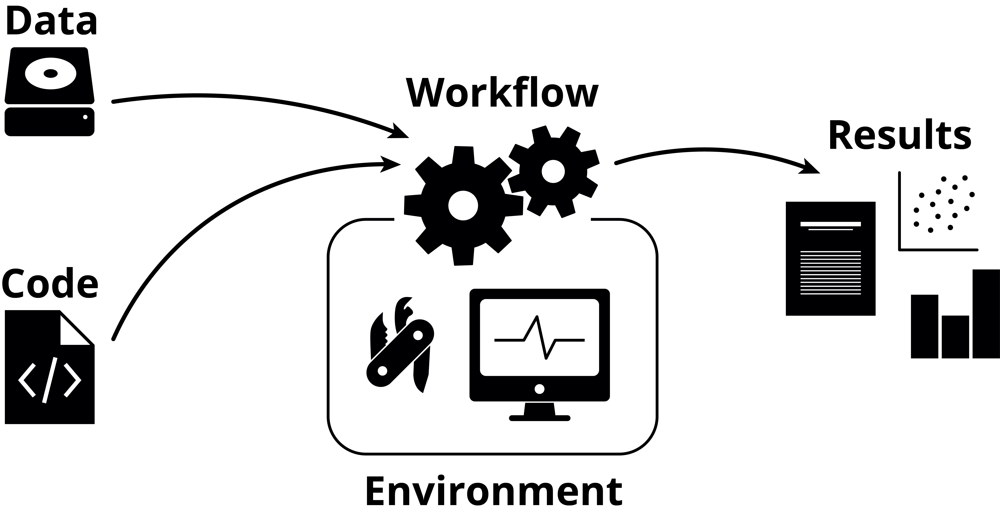

::: {.at-a-glance}
- **Time:** about 45 minutes of reading, before or after Lecture 1; the forensic reconstruction (20 minutes) is done in class.
- **Slides (PDF):** [Lecture 1, Reproducibility](../slides/Lecture1_Reproducibility.pdf)
- **You need:** a web browser; Pixi for the *Break it* step.
- **You will have:** a one-line verdict on one paper from your field (where it sits on the reproducibility ladder, and what stopped you going higher), which you audit in [lesson 01b](01b-open-science.qmd).
:::

## Overview

### Why this matters

> Your most important collaborator is you, six months from now, and they
> don't answer email.

Almost every result in computational biology is the end of a long chain:
samples are sequenced, reads are downloaded, trimmed and aligned to a
reference, variants or peaks are called with dozens of settings, tables are
filtered and joined, and a figure is drawn. The paper describes that chain in
a few paragraphs. The details that decide the result (a software version, a
default that changed, a sample dropped by hand, the genome build) are rarely
among them. When the chain cannot be rerun, nobody can check a surprising
result, find where an error came in, or build on the work without starting
over. That includes the authors themselves.

This lesson is about why that happens so often, how we know, and what to do
about it. It is the argument for everything else in the course.

### What you do in this lesson

You read three cases that show different ways a published result can fail,
weigh the evidence on how common such failures are, and learn the
vocabulary precisely enough to say *which* kind of failure you are looking at.
You then trace the causes, from questionable statistics to unpinned software,
and map each cause to a practice (and a lesson of this course) that prevents
it. In class you reconstruct the hidden decisions behind a four-sentence
methods paragraph; at home you break a tiny analysis on purpose and place a
real paper on the reproducibility ladder.

### Learning outcomes

After this lesson you can:

1. **Distinguish** reproducibility, replicability, robustness and
   generalizability, and say which one a given failure is about.
2. **Interpret** the evidence from replication and re-execution studies
   without overclaiming what the numbers mean.
3. **Diagnose** why results fail to reproduce: questionable research
   practices, missing pieces, software drift, moving references, hidden state,
   machine-specific behavior and unseeded randomness.
4. **Explain** the extra threats in machine learning, such as data leakage,
   and how they differ from plain irreproducibility.
5. **Map** each cause to one of the five pillars of computational
   reproducibility, and **place** a published study on the reproducibility
   ladder.

## 1. Three ways a result can fail

### An academic star who invented his data

Diederik Stapel was one of the most successful social psychologists in Europe.
His studies were elegant and his data looked almost perfect. One, published in
*Science* in 2011, reported that people in a messy environment (a
Utrecht railway station during a cleaners' strike) relied more on stereotypes
and discriminated more. The station setting, the seating arrangement and the
participants never existed: the data were invented. Three junior researchers
in his department reported their suspicions in 2011; the investigations that
followed found fraud in dozens of his papers, 58 of which have been retracted,
and several PhD theses that he supervised were affected.

Stapel is the case people remember, but it is the wrong model for most
irreproducible research. Fabrication is rare. What the case does show is how a
culture of "publish or perish", in which a striking result is rewarded and
nobody asks for the raw data, lets problems run for years. The same culture
produces far more ordinary failures.

### Duke: an analysis nobody could check

In 2006, Anil Potti, Joseph Nevins and colleagues at Duke University reported
in *Nature Medicine* that gene-expression signatures derived from cancer cell
lines could predict which chemotherapy drug would work for an individual
patient. It was exactly what personalized oncology hoped for, and clinical
trials began to assign patients to treatment using the signatures.

Keith Baggerly and Kevin Coombes, two biostatisticians at MD Anderson Cancer
Center, tried to reproduce the analysis so their own clinicians could use it.
The code and the exact data were not available, so they worked backwards from
the published results: what Baggerly called **forensic bioinformatics**.
They found gene lists shifted by one row (an off-by-one error, as when a
header row is miscounted), the labels "sensitive" and "resistant" reversed for
some samples, and samples that appeared more than once (Baggerly and Coombes
2009). Reversed labels matter in a trial: they can steer a patient towards the
drug the model should have ranked last.

Their reports did not stop the trials at first: an internal review resumed
them in early 2010. The trials stopped for good later that year, after it
emerged that Potti had falsely claimed a Rhodes Scholarship. The *Nature
Medicine* paper and many others were retracted, a 2012 Institute of Medicine
report recommended that any omics-based test be fully specified, with its data
and code, before it is used to guide treatment in a trial, and in 2015 the US
Office of Research Integrity found that Potti had committed research
misconduct.

Two lessons matter here. First, it took two experts years of reconstruction to
find errors that a shared script and a sample sheet would have exposed in an
afternoon. Second, reproducibility would not have made the signatures
*correct*: rerunning a mislabeled analysis reproduces the mislabeling. What it
would have done is make the errors visible, early, to anyone who looked.

### Honest errors, at scale

Most failures involve no misconduct at all:

- **A flipped column.** In 2006 the structural biologist Geoffrey Chang
  retracted five papers, three of them in *Science*, describing the structure
  of a membrane transport protein. A home-made data-analysis program had
  swapped two columns of data, inverting the structures (Miller 2006). Other
  groups had spent years working from, or arguing against, the published
  models.
- **Genes that became dates.** Spreadsheet software silently converts gene
  symbols such as `SEPT2` and `MARCH1` into dates. A scan of supplementary
  files found these errors in about one in five papers with Excel gene lists
  (Ziemann et al. 2016); five years later the rate had risen to 30.9%
  (3,436 of 11,117 papers; Abeysooriya et al. 2021). In 2020 the gene
  nomenclature committee renamed the affected genes (`SEPTIN2`, `MARCHF1`),
  partly to stop the errors (Bruford et al. 2020).
- **Rows that disappeared.** In October 2020 nearly 16,000 positive COVID-19
  tests in England went unreported for about a week, so their contacts were
  not traced. The results were collected in Excel's old `.xls` format, which
  holds at most 65,536 rows per sheet (the current `.xlsx` holds 1,048,576);
  rows past the limit were dropped without a warning.

In each case the error was ordinary, the tool did what it was told, and
nobody could see the step that went wrong. That is the problem this course
addresses.

## 2. How big is the problem?

### What researchers report

In a *Nature* survey of 1,576 researchers, more than 70% said they had tried
and failed to reproduce another scientist's experiment, and more than half had
failed to reproduce one of their own; 90% agreed there was a "significant" or
"slight" reproducibility crisis (Baker 2016). Surveys measure perception, not
rates, but the perception is widespread.

### What large replication projects found

| Project | What it did | What it found |
|---------|-------------|---------------|
| Reproducibility Project: Psychology (Open Science Collaboration 2015) | repeated 100 studies from three leading psychology journals, with the original authors' materials where possible | 97% of the originals had significant results; 36% of the replications did; effects in the replications were on average about half as large |
| Reproducibility Project: Cancer Biology (Errington et al. 2021a, 2021b) | planned to repeat 193 experiments from 53 high-impact papers, with protocols peer reviewed before any work began | could repeat only **50 experiments from 23 papers**; for positive effects the median effect size was **85% smaller**, and 40% (39 of 97) replicated on at least three of five criteria |
| Brazilian Reproducibility Initiative ([reprodutibilidade.bio.br](https://www.reprodutibilidade.bio.br/); design in Amaral et al. 2019) | 56 laboratories across Brazil repeated experiments that use common biomedical methods: 143 replications of 56 experiments, 2019 to 2025 | success rates between about 15% and 45%, depending on how success was defined |

The cancer biology project is especially telling for this course, because its
biggest obstacle was not the biology. The data needed to compute effect sizes
were publicly available for **4 of the 193** experiments; the authors could
not provide them for 68%; and **none** of the 193 experiments was described in
enough detail to design a replication from the paper alone (Errington et al.
2021b). Before anyone could test whether the results held, they had to find
out what had been done.

### What happens when someone reruns the code

Computational work should be the easy case: no reagents, no animals, just
files and programs. The evidence says otherwise.

| Study | What was checked | Result |
|-------|------------------|--------|
| Ioannidis et al. 2009 | 18 microarray papers in *Nature Genetics*; one table or figure each, by two independent teams | 2 reproduced in principle, 6 partially, **10 not at all**; the main cause was that the data were not available |
| Stodden et al. 2018 | 204 papers in *Science* after the journal began requiring data and code on request | artifacts obtained for 44%; findings reproduced for **26%** |
| Pimentel et al. 2019 | about 860,000 attempts to run Jupyter notebooks on GitHub | 24% ran without error; **4%** gave the same results |
| Trisovic et al. 2022 | over 9,000 R files in replication packages on Harvard Dataverse | **74%** failed on the first run; 56% still failed after automatic clean-up |
| Samuel and Mietchen 2024 | 22,578 Python notebooks linked to biomedical papers | 1,203 ran without errors; **879** gave the published results |

: {tbl-colwidths="[22,40,38]"}

The reasons were mostly mundane: a package that was not listed, a file path
that only existed on the author's computer, a cell run out of order, an input
file that was never shared.

### Reading these numbers carefully

These studies are not measurements of one quantity, and a careful reader
avoids three common mistakes:

- **"36% of psychology is true."** No. A replication can fail because the
  original was a false positive, because the replication was underpowered,
  or because populations and procedures differed. A single replication with
  *p* = 0.08 does not show that the original was false; compare effect sizes
  and their uncertainty instead.
- **"Smaller effects mean fraud."** Shrinking effects are what you expect
  when small studies are published only if they cross a significance
  threshold (the "winner's curse"; see [section 5](#where-research-goes-wrong)).
- **Comparing percentages across studies.** Each study sampled different
  papers (often high-profile ones), defined success differently and had
  different resources.

What the evidence *does* show, consistently, is that a large share of
published work cannot be checked at all, because the data, code or details
needed to check it are missing. That part is entirely within our control.

## 3. What the words mean

Fields have used "reproducible" and "replicable" in different, sometimes
opposite, ways. The US National Academies of Sciences, Engineering, and
Medicine (NASEM 2019) settled on definitions that this course uses:

- **Reproducibility:** obtaining consistent results using the same input
  data, computational steps, methods, code and conditions of analysis.
- **Replicability:** obtaining consistent results across studies aimed at
  answering the same scientific question, each of which has obtained its own
  data.

Reproducibility is mostly a computational question, and it should be close to
guaranteed. Replicability is a scientific question: some failures are
expected, and they are informative. A rigorous, honest, well-analyzed study
should always be reproducible, yet it may still fail to replicate, because
nature is noisy and contexts differ.

The Turing Way extends this to a 2 × 2 grid ([figure](https://book.the-turing-way.org/reproducible-research/overview/overview-definitions)),
which asks what changes:

| | Same data | Different data |
|-|-----------|----------------|
| **Same analysis** | **Reproducible**: rerun my code on my data | **Replicable**: same method, new cohort |
| **Different analysis** | **Robust**: other reasonable pipelines agree | **Generalizable**: holds beyond the original setting |

A finding you can trust survives all four. In genomics, *robust* often means
"does the variant call survive a different aligner or a stricter filter?",
and *generalizable* often means "does the model work in another hospital, on
another sequencing platform, or in people of other ancestries?".

::: {.callout-note collapse="true" title="Words differ between fields: define them when you write"}
Goodman, Fanelli and Ioannidis (2016) proposed a different split: *methods
reproducibility* (is there enough detail to repeat exactly what was done?),
*results reproducibility* (does an independent repeat give the same results?)
and *inferential reproducibility* (would others draw the same conclusions from
the evidence?). The Association for Computing Machinery's artifact badges used
"reproducible" and "replicable" the other way round until 2020, when they were
swapped to match NASEM. When you write about reproducibility, say which
meaning you use.
:::

**Reproducibility is the minimum.** If a result cannot be reproduced from its
own data and code, a failed replication is impossible to interpret: was the
biology different, or was the analysis? This is why the rest of the course
concentrates on reproducibility first.

### A spectrum, not a yes or no

Roger Peng (2011) described reproducibility as a spectrum, from a paper alone
(not reproducible) to full replication (the gold standard), with each step
adding code, data, or links that let a reader execute them. The lectures turn
this into a ladder you can climb one rung at a time:

| Rung | What a reader gets | What they can check |
|------|--------------------|---------------------|
| 0 | the paper and its figures | nothing beyond the text |
| 1 | + code | the logic, by reading |
| 2 | + data, or accessions to it | the numbers, if they can rebuild the software |
| 3 | + a pinned environment (lock file, container) | the numbers, on their own computer |
| 4 | + one command that reruns everything from raw data | the whole analysis, in an afternoon |
| 5 | + tests, automated reruns, an archived release with a DOI | that it still works, years later |

By the end of this course your LTEE project reaches rung 5.

::: {.callout-tip collapse="true" title="Check yourself: which word?"}
1. You rerun a published Snakemake workflow on the authors' FASTQ files and
   get the same variant calls. *Reproducible.*
2. A second cohort, sequenced in another country, shows the same association.
   *Replicable* (and evidence of generalizability, if the populations differ).
3. Switching from BWA to Bowtie2 and from one variant caller to another
   leaves the conclusion unchanged. *Robust.*
4. A model trained on one hospital's images works in three others with
   different scanners. *Generalizable.*
5. You rerun the code and get a different number because a package changed.
   The result is *not reproducible* as published, though it may become so
   once you pin the original version.
:::

## 4. Why bother? Five selfish reasons

Reproducibility is usually sold as a duty to science. Florian Markowetz (2015)
argued that it is first in your own interest:

1. **It helps you avoid disaster.** Errors found before publication are
   cheap; errors found after it are retractions. Chang's flipped column cost
   five papers.
2. **It makes it easier to write papers.** When every number in the
   manuscript comes from a script, "where did this figure come from?" has an
   answer, and the methods section half writes itself.
3. **It helps reviewers see it your way.** A reviewer who can rerun your
   analysis argues with your science, not with your description of it.
4. **It enables continuity of your work.** Students and postdocs leave; a
   project that only runs on one person's laptop leaves with them.
5. **It helps to build your reputation.** Work that others can reuse gets
   used, cited and trusted.

The fourth reason is the one that applies to every graduate student: the
person most likely to rerun your analysis is you, six months from now, when a
reviewer asks for one more figure. When should you worry about
reproducibility? Before you start a project, while you write the code, when
you write the paper, when you co-author one, when you review one: in short,
**all the time**. It is cheapest on day one and most expensive the week before
submission.

## 5. Where research goes wrong {#where-research-goes-wrong}

### The research cycle and its weak points

Research runs in a cycle: generate a hypothesis, design a study, collect
data, analyze it, interpret it, publish, and start the next experiment. Each
step has a characteristic way of going wrong (Munafò et al. 2017, after Chris
Chambers). Most of these practices are not fraud: they are choices that feel
reasonable at the time and inflate the false-positive rate.

| Practice | What it looks like | What counters it |
|----------|--------------------|------------------|
| **p-hacking** | trying analyses (covariates, exclusions, transformations) until something crosses *p* < 0.05 | an analysis plan fixed in advance; report everything you tried |
| **Forking paths** | many defensible choices, only one reported, even without deliberate searching (Gelman and Loken 2014) | multiverse or sensitivity analysis: show the result across reasonable choices |
| **HARKing** | Hypothesizing After the Results are Known: presenting a post hoc finding as if it were the original hypothesis (Kerr 1998) | preregistration; label exploratory work as exploratory |
| **Low power** | small samples, so true effects are often missed and significant ones are often false or exaggerated | power analysis; larger samples; collaboration across labs |
| **Publication bias** | null results stay in the drawer, so the literature over-represents positive ones | Registered Reports; preprints; publishing null results |

Simmons, Nelson and Simonsohn (2011) showed how quickly these add up: with a
handful of common, undisclosed flexibilities (when to stop collecting data,
which outcome to report, whether to add a covariate), the chance of finding a
"significant" effect that does not exist rose from the nominal 5% to above
60% in their simulations.

Low power deserves a second look, because it explains the shrinking effects
in the replication projects. Button et al. (2013) estimated that the median
statistical power in neuroscience studies was about 21%. In a field like
that, the studies that happen to reach significance are mostly the ones that
overestimated the effect, so when they are repeated, the effect shrinks. This
is the **winner's curse**, and it needs no misconduct at all.

### Why the same data and code give different answers

Computational analyses have their own failure points, even when the
statistics are sound:

| Cause | What it looks like | A real case |
|-------|--------------------|-------------|
| **Missing pieces** | code never shared; raw data not deposited; a step done by hand in a spreadsheet | most failures in Ioannidis et al. (2009) were data that were not available |
| **Software drift** | unpinned package versions; a default that changed between releases | FreeSurfer 5.0.0 gave brain volumes that differed by 8.8% on average (up to 64%) from earlier versions, and results also depended on the workstation and macOS version (Gronenschild et al. 2012); scikit-learn's random forests went from 10 to 100 trees by default in version 0.22 |
| **Moving references** | genome build (hg19 or hg38), annotation release or database snapshot not recorded | the same coordinates name different bases in different builds; gene models change between Ensembl releases |
| **Hidden state** | notebook cells run out of order; variables left in memory from an earlier run | the main failure mode in the notebook studies above |
| **Machine-specific behavior** | hard-coded paths; operating-system-dependent file ordering; multi-threaded or GPU arithmetic | widely used chemistry scripts gave different NMR predictions on different operating systems, because they assumed files were listed in sorted order (Bhandari Neupane et al. 2019) |
| **Unseeded randomness** | subsampling, clustering, train/test splits, UMAP or t-SNE layouts without a fixed seed | a "cluster" that appears with one seed and vanishes with another |

: {tbl-colwidths="[18,38,44]"}

The *Break it* step below reproduces one of these failures on your own
computer in under a minute.

::: {.callout-note title="Same code, same data, different answer?"}
Set and report seeds for everything random, but do not stop there: one lucky
seed is not a result, so check that conclusions hold across several. Expect
small numerical drift where floating-point sums are reordered (threads,
GPUs), and **define "the same" in advance**: identical files, identical
within a tolerance, or the same conclusion?
:::

### Who is responsible?

When a result cannot be reproduced, it is tempting to blame the individual.
Responsibility is shared. **Researchers** document their methods, data and
code, and train their students to do the same. **Institutions** set policies
and reward reproducible work in hiring and promotion. **Funders** require
open code and data, and fund the time it takes. **Journals** check that code
and data are available, and publish replications and null results.
**Societies and the public** ask for transparency. But the one link in that
chain you control today is the first: responsibility begins with the
researcher.

::: {.callout-note title="Think, pair, share (8 minutes, in class)"}
**Think (2 minutes):** write down one or two factors that hurt
reproducibility in your own field. **Pair (3 minutes):** with a neighbor,
discuss how each could be fixed, and by whom. **Share (3 minutes):** report
back; the class sorts the answers into technical, human, statistical and
incentive problems.
:::

## 6. Machine learning and AI

Machine learning has a reproducibility crisis of its own. Code, data and
trained models are often not shared; hyperparameters and preprocessing go
undocumented; results depend on the GPU type and the random seed; and the
pressure to beat a benchmark rewards cherry-picking (Ball 2023).

The most damaging problem is **data leakage**: information from the test set
reaches the model during training, so its reported performance is inflated.
Kapoor and Narayanan (2023) found leakage in published work in 17 fields,
affecting 294 papers, sometimes with wildly over-optimistic conclusions; they
describe eight kinds, from textbook errors to subtle ones. Two are common in
genomics and medicine:

- **Preprocessing or feature selection on all the data before splitting.**
  If you choose the 50 most differentially expressed genes using every
  sample, and only then split into training and test sets, the test set
  helped choose the features. Every step that learns from data belongs inside
  the training fold.
- **Non-independent samples.** Several samples from the same patient, or
  near-identical sequences, on both sides of the split. The model recognizes
  the patient, not the disease.

Leakage is not irreproducibility: a leaky analysis can rerun perfectly and
give the same inflated number every time. It is a threat to **validity**,
which reproducibility makes visible but does not fix.

Generative AI adds new risks. Large language models can produce plausible
but wrong code, text and citations; the speed of AI-assisted publishing
outpaces peer review; and in 2025 researchers found manuscripts with hidden
instructions, in white or tiny text, telling AI reviewers to give only
positive reviews (Lin 2025). Proprietary models and the compute needed to
train large ones put independent verification out of reach for most groups.

AI is also a tool *for* reproducibility: it can draft tests, documentation,
Dockerfiles and workflow rules, log experiments automatically (with tools
such as MLflow or Weights & Biases) and spot anomalies in data. Use it, then
check what it writes, and say in your methods that you used it.

## 7. The toolkit: five pillars

Every analysis, whatever the field, has the same parts: data and code go into
a workflow that runs in a software environment and produces results.

{fig-alt="Diagram: data and code go into a workflow that runs in a software environment and produces results such as reports and figures." width="72%" fig-align="center"}

Ziemann, Poulain and Bora (2023) organized the practices that keep those
parts reproducible into **five pillars of computational reproducibility**.
Each answers some of the causes in [section 5](#where-research-goes-wrong):

| Pillar | What it prevents | In this course |
|--------|------------------|----------------|
| **Literate programming**: code, results and explanation in one document | undocumented steps; numbers copied by hand into a manuscript | [06 Jupyter](06-jupyter.qmd), [07 Quarto](07-quarto.qmd) |
| **Code version control and sharing** | "which version of the script made Figure 3?"; code that never leaves the laptop | [04 Git and GitHub](04-git.qmd) |
| **Compute environment control** | software drift; "works on my machine" | [05 Pixi](05-pixi.qmd), [08 Containers](08-containers.qmd) |
| **Persistent data sharing** | missing pieces; moving references | [03 Data management](03-data-management.qmd), [12 Putting it together](12-putting-it-together.qmd) |
| **Documentation** | nobody knows what to run, in which order, or why | [11 Documentation](11-documentation.qmd), and every lesson |

Two practices tie the pillars together. **Workflow managers**
([09 Snakemake](09-snakemake.qmd), [10 Nextflow](10-nextflow.qmd)) turn a
pipeline into one command that knows what depends on what: a methods section
that cannot be out of date. **Checksums and automated reruns** (tests and
continuous integration) prove that the inputs are the ones you think and that
the whole thing still runs.

{fig-alt="Diagram: the same report.qmd, with the same charts and REL606 variant calls, today and five years later. Both come from the same inputs: data and checksums, code and Git history, the environment in pixi.lock, and a container built from a Dockerfile." width="85%"}

::: {.callout-tip collapse="true" title="Ten simple rules for reproducible computational research (Sandve et al. 2013)"}
1. For every result, keep track of how it was produced.
2. Avoid manual data manipulation steps.
3. Archive the exact versions of all external programs used.
4. Version-control all custom scripts.
5. Record all intermediate results, when possible in standard formats.
6. For analyses that include randomness, note the underlying random seeds.
7. Always store the raw data behind plots.
8. Generate hierarchical analysis output, allowing layers of increasing detail to be inspected.
9. Connect textual statements to underlying results.
10. Provide public access to scripts, runs and results.

More than a decade on, every rule still applies, and each maps onto one of
the pillars.
:::

::: {.callout-note title="A minimum reproducibility package"}
When you hand an analysis to someone else, give them: (1) identifiable inputs
and reference files, with checksums; (2) the code at a specific commit or
release; (3) the environment, as a lock file or a container recipe; (4) one
entry point: a command or a workflow; (5) the expected outputs, and a way to
check them; (6) a README that states the limitations and any access
restrictions.
:::

## 8. In class: forensic reconstruction (20 minutes) {#forensic-reconstruction}

Here is a typical methods paragraph (invented for this exercise, but you
have read many like it):

> Reads were trimmed and aligned to the human genome using Bowtie2 with
> default parameters. Duplicates were removed and peaks were called with
> MACS2 (*p* < 0.01). Differential binding between conditions was assessed
> with DESeq2, and regions with FDR < 0.05 were considered significant. Motif
> enrichment was performed using HOMER.

1. **Alone (8 minutes).** List every decision you would need to rerun this
   analysis. Circle each one the paragraph leaves unstated.
2. **In pairs (8 minutes).** Draw the analysis as boxes and arrows. On each
   arrow, write what is missing to make that step rerunnable.
3. **In pairs (4 minutes).** Place the paper on the ladder (0 to 5) and write
   the one fix that would help a reader most.

::: {.callout-tip collapse="true" title="Debrief: four sentences, twenty-plus hidden decisions"}
- **Data:** accessions; replicates per condition; input or control samples;
  read length; paired or single end.
- **References:** genome build; which contigs were kept; blacklisted regions;
  annotation release; HOMER's genome and motif library versions.
- **Parameters:** trimming tool and adapters; mapping-quality filter;
  duplicate-removal tool; MACS2 mode and genome size; how peaks from
  replicates were merged into a consensus set; how reads were counted in
  peaks; the DESeq2 design formula; HOMER's background and region size.
- **Software:** a version for each of the four named tools, and for the
  unnamed ones (trimmer, duplicate removal, counting); and what "default"
  meant in *that* version.

A shared workflow file and a lock file would have answered every one of these
questions without a single extra sentence of prose. Prose cannot carry a
pipeline; code, environments and workflows can.
:::

::: {.callout-note collapse="true" title="At home: three kinds of problem in one repository"}
A paper reports 92% accuracy for a model that classifies 150 tumor samples.
Its GitHub repository contains one notebook and no environment file. The
notebook reads `data/final.csv`, which is not in the repository. The paper
says "fivefold cross-validation", but the notebook selects the top genes on
all 150 samples before the cross-validation loop.

Name one problem of **access**, one of **computational reproducibility** and
one of **validity**. Which of them could inflate the reported accuracy even if
the notebook ran perfectly? What is the smallest set of changes after which
you would believe the number?

*Answer.* Access: `final.csv` is missing, and nothing says how it was made
from raw data. Reproducibility: no environment file, so package versions are
unknown, and a notebook may depend on the order its cells were run. Validity:
feature selection before cross-validation is leakage, and it inflates the
accuracy even when everything else is perfect. Fix: deposit the raw data (or
an accession) and the script that makes `final.csv`; pin the environment;
move feature selection inside each training fold; and test the final model on
an independent cohort.
:::

## Break it: same code, same data, a different file

Software that gives a different file on every run, with nothing changed, is
not a curiosity: it is what makes "is my result the same as yours?" hard to
answer. Here is a three-line analysis that writes the genes that passed a
filter. Make a folder for this lesson and save it:

```{.bash .run}
mkdir -p ~/cbio7501/break-it-01a
cd ~/cbio7501/break-it-01a
```

```{.python filename="hits.py" .write}
# Write the genes that passed the filter, one per line.
hits = {"TP53", "BRCA1", "EGFR", "KRAS", "MYC", "PTEN", "SEPTIN2", "MARCHF1"}
with open("hits.txt", "w") as f:
    for gene in hits:
        print(gene, file=f)
```

Run it five times, and print the file on one line each time:

```{.bash .run}
for run in 1 2 3 4 5; do
  pixi exec python hits.py
  paste -s -d " " hits.txt
done
```

```text
BRCA1 MARCHF1 EGFR PTEN KRAS SEPTIN2 TP53 MYC
SEPTIN2 MYC PTEN MARCHF1 EGFR KRAS TP53 BRCA1
MARCHF1 BRCA1 PTEN MYC SEPTIN2 EGFR KRAS TP53
BRCA1 TP53 PTEN SEPTIN2 KRAS EGFR MARCHF1 MYC
TP53 KRAS MYC SEPTIN2 EGFR MARCHF1 PTEN BRCA1
```

Your orders will differ from these, and from each other. The data and the
code did not change; the *order* of the genes did. A Python `set` has no
order, and Python randomizes how it stores text each time it starts (a
security feature), so the genes come out differently on each run. Five runs,
five different files: their checksums ([lesson 03](03-data-management.qmd))
all differ, and a later step that takes "the first three genes" gets a
different answer every time.

Fix it by making the order explicit, and run it again:

```{.bash .run}
sed -i.bak 's/for gene in hits:/for gene in sorted(hits):/' hits.py
for run in 1 2 3; do
  pixi exec python hits.py
  paste -s -d " " hits.txt
done
```

```text
BRCA1 EGFR KRAS MARCHF1 MYC PTEN SEPTIN2 TP53
BRCA1 EGFR KRAS MARCHF1 MYC PTEN SEPTIN2 TP53
BRCA1 EGFR KRAS MARCHF1 MYC PTEN SEPTIN2 TP53
```

Two lessons. Anything a program does not promise (the order of a set, of the
files in a folder, of the results of a parallel loop) can change between runs,
computers and versions. And decide in advance what "the same result" means:
here the same *set* of genes came out every time, but not the same *file*.

## Homework: place a paper on the ladder

Pick one recent paper in your area: one you cite, or one close to the
analysis you plan for your capstone. Try to find its raw data, its code and
its software versions. Spend no more than 30 minutes. Bring a one-line
verdict: **where does it sit on the ladder, and what stopped you going one
rung higher?** In [lesson 01b](01b-open-science.qmd#openness-audit) you audit
the same paper in detail.

## Apply it to your own project

Take the analysis you know best (your thesis, your last paper, or the one you
plan for the capstone) and write down, honestly, which rung of the ladder it
is on today. Then list the decisions in it that live only in your head: the
genome build, a sample you dropped, the version of the aligner, the threshold
you tried three times. Those are the things the rest of this course will move
out of your head and into files.

## Key points

- Reproducibility (same data, same analysis) should be close to certain;
  replicability (new data) is the scientific test. Robustness and
  generalizability go further.
- Across fields, many published results cannot be checked at all, because
  data, code or details are missing; effects often shrink when studies are
  repeated.
- Most failures are honest and mundane: missing files, unpinned versions,
  moving references, hidden state, paths and seeds.
- A reproducible analysis can still be wrong (leakage, mislabeling), but it
  lets anyone see why.
- Prose cannot carry a pipeline; code, environments and workflows can. Climb
  the ladder one rung at a time, starting with your next analysis.

## Further reading

The core readings for this lesson:

- National Academies of Sciences, Engineering, and Medicine (2019). *Reproducibility and Replicability in Science*. <https://doi.org/10.17226/25303>
- Sandve GK, Nekrutenko A, Taylor J, Hovig E (2013). Ten simple rules for reproducible computational research. *PLoS Comput Biol* 9:e1003285. <https://doi.org/10.1371/journal.pcbi.1003285>
- Wilson G, Bryan J, Cranston K, et al. (2017). Good enough practices in scientific computing. *PLoS Comput Biol* 13:e1005510. <https://doi.org/10.1371/journal.pcbi.1005510>
- Markowetz F (2015). Five selfish reasons to work reproducibly. *Genome Biol* 16:274. <https://doi.org/10.1186/s13059-015-0850-7>
- Ziemann M, Poulain P, Bora A (2023). The five pillars of computational reproducibility: bioinformatics and beyond. *Brief Bioinform* 24:bbad375. <https://doi.org/10.1093/bib/bbad375>
- Baggerly KA, Coombes KR (2009). Deriving chemosensitivity from cell lines: forensic bioinformatics and reproducible research in high-throughput biology. *Ann Appl Stat* 3:1309–1334. <https://doi.org/10.1214/09-AOAS291>

Going further: Noble (2009) on organizing a computational biology project,
which is where [lesson 02](02-project-organization.qmd) starts; Kapoor and
Narayanan (2023) on leakage; and The Turing Way's
[guide for reproducible research](https://book.the-turing-way.org/reproducible-research/reproducible-research).

## References

- Abeysooriya M, Soria M, Kasu MS, Ziemann M (2021). Gene name errors: lessons not learned. *PLoS Comput Biol* 17:e1008984. <https://doi.org/10.1371/journal.pcbi.1008984>
- Amaral OB, Neves K, Wasilewska-Sampaio AP, Carneiro CF (2019). The Brazilian Reproducibility Initiative. *eLife* 8:e41602. <https://doi.org/10.7554/eLife.41602>
- Baker M (2016). 1,500 scientists lift the lid on reproducibility. *Nature* 533:452–454. <https://doi.org/10.1038/533452a>
- Ball P (2023). Is AI leading to a reproducibility crisis in science? *Nature* 624:22–25. <https://doi.org/10.1038/d41586-023-03817-6>
- Bhandari Neupane J, Neupane RP, Luo Y, et al. (2019). Characterization of leptazolines A–D, polar oxazolines from the cyanobacterium *Leptolyngbya* sp., reveals a glitch with the "Willoughby–Hoye" scripts for calculating NMR chemical shifts. *Org Lett* 21:8449–8453. <https://doi.org/10.1021/acs.orglett.9b03216>
- Bruford EA, Braschi B, Denny P, et al. (2020). Guidelines for human gene nomenclature. *Nat Genet* 52:754–758. <https://doi.org/10.1038/s41588-020-0669-3>
- Button KS, Ioannidis JPA, Mokrysz C, et al. (2013). Power failure: why small sample size undermines the reliability of neuroscience. *Nat Rev Neurosci* 14:365–376. <https://doi.org/10.1038/nrn3475>
- Errington TM, Mathur M, Soderberg CK, et al. (2021a). Investigating the replicability of preclinical cancer biology. *eLife* 10:e71601. <https://doi.org/10.7554/eLife.71601>
- Errington TM, Denis A, Perfito N, Iorns E, Nosek BA (2021b). Challenges for assessing replicability in preclinical cancer biology. *eLife* 10:e67995. <https://doi.org/10.7554/eLife.67995>
- Gelman A, Loken E (2014). The statistical crisis in science. *American Scientist* 102:460–465. <https://doi.org/10.1511/2014.111.460>
- Goodman SN, Fanelli D, Ioannidis JPA (2016). What does research reproducibility mean? *Sci Transl Med* 8:341ps12. <https://doi.org/10.1126/scitranslmed.aaf5027>
- Gronenschild EHBM, Habets P, Jacobs HIL, et al. (2012). The effects of FreeSurfer version, workstation type, and Macintosh operating system version on anatomical volume and cortical thickness measurements. *PLoS ONE* 7:e38234. <https://doi.org/10.1371/journal.pone.0038234>
- Ioannidis JPA, Allison DB, Ball CA, et al. (2009). Repeatability of published microarray gene expression analyses. *Nat Genet* 41:149–155. <https://doi.org/10.1038/ng.295>
- Kapoor S, Narayanan A (2023). Leakage and the reproducibility crisis in machine-learning-based science. *Patterns* 4:100804. <https://doi.org/10.1016/j.patter.2023.100804>
- Kerr NL (1998). HARKing: hypothesizing after the results are known. *Pers Soc Psychol Rev* 2:196–217. <https://doi.org/10.1207/s15327957pspr0203_4>
- Lin Z (2025). Hidden prompts in manuscripts exploit AI-assisted peer review. arXiv:2507.06185. <https://arxiv.org/abs/2507.06185>
- Miller G (2006). A scientist's nightmare: software problem leads to five retractions. *Science* 314:1856–1857. <https://doi.org/10.1126/science.314.5807.1856>
- Munafò MR, Nosek BA, Bishop DVM, et al. (2017). A manifesto for reproducible science. *Nat Hum Behav* 1:0021. <https://doi.org/10.1038/s41562-016-0021>
- Noble WS (2009). A quick guide to organizing computational biology projects. *PLoS Comput Biol* 5:e1000424. <https://doi.org/10.1371/journal.pcbi.1000424>
- Open Science Collaboration (2015). Estimating the reproducibility of psychological science. *Science* 349:aac4716. <https://doi.org/10.1126/science.aac4716>
- Peng RD (2011). Reproducible research in computational science. *Science* 334:1226–1227. <https://doi.org/10.1126/science.1213847>
- Pimentel JF, Murta L, Braganholo V, Freire J (2019). A large-scale study about quality and reproducibility of Jupyter notebooks. *Proceedings of the 16th International Conference on Mining Software Repositories*, 507–517. <https://doi.org/10.1109/MSR.2019.00077>
- Samuel S, Mietchen D (2024). Computational reproducibility of Jupyter notebooks from biomedical publications. *GigaScience* 13:giad113. <https://doi.org/10.1093/gigascience/giad113>
- Simmons JP, Nelson LD, Simonsohn U (2011). False-positive psychology: undisclosed flexibility in data collection and analysis allows presenting anything as significant. *Psychol Sci* 22:1359–1366. <https://doi.org/10.1177/0956797611417632>
- Stodden V, Seiler J, Ma Z (2018). An empirical analysis of journal policy effectiveness for computational reproducibility. *PNAS* 115:2584–2589. <https://doi.org/10.1073/pnas.1708290115>
- Trisovic A, Lau MK, Pasquier T, Crosas M (2022). A large-scale study on research code quality and execution. *Sci Data* 9:60. <https://doi.org/10.1038/s41597-022-01143-6>
- Ziemann M, Eren Y, El-Osta A (2016). Gene name errors are widespread in the scientific literature. *Genome Biol* 17:177. <https://doi.org/10.1186/s13059-016-1044-7>
