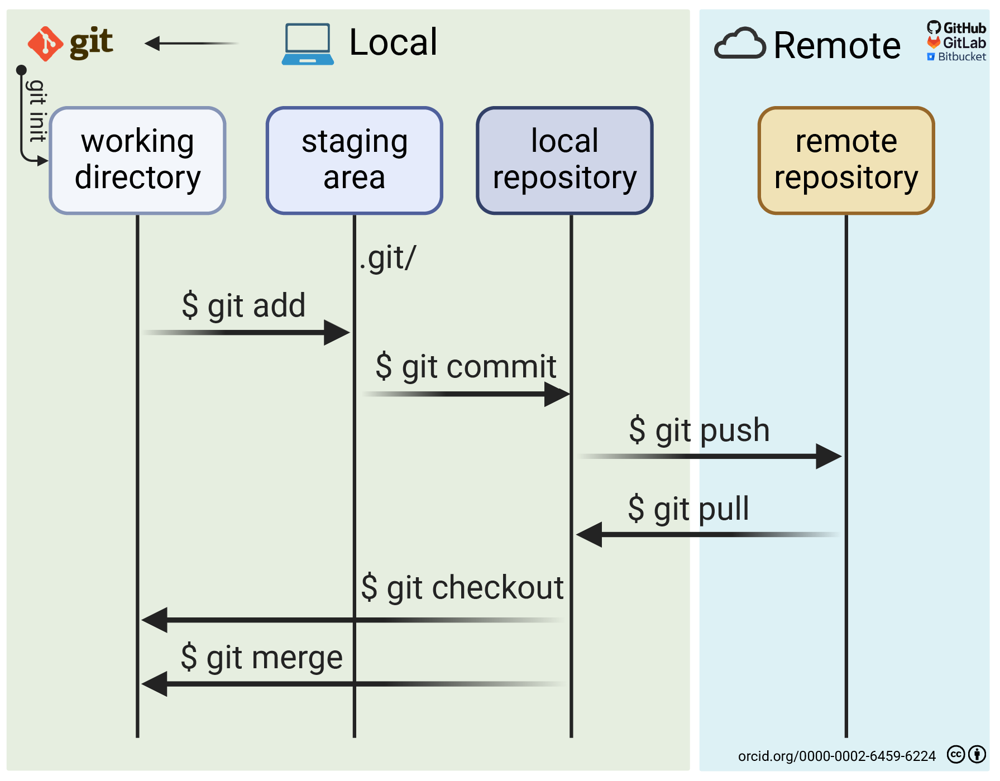

::: {.at-a-glance}
- **Time:** two sessions: sections 1 to 6 (80 minutes: Git on your laptop and on GitHub), then 7 to 10 (70 minutes: branches, a merge conflict, tags and pull requests).
- **Slides:** [Git and GitHub](../lectures/04-git/04-git.qmd)
- **You need:** the `ltee-project` from [lesson 02](02-project-organization.qmd) and the [lesson 03 hands-on](03-data-management.qmd#hands-on); Git and a GitHub account with an SSH key ([lesson 00](00-setup.qmd#git-and-github)).
- **You will have:** your project on GitHub, with a history, a merged pull request, and a check from GitHub Actions on every push.
:::

## Overview

Version control records every change to your project: what changed, when,
who did it and why. It lets you go back to any earlier state, try ideas on a
branch without risk, and work with others without emailing files. Git is the
standard tool; GitHub hosts Git repositories online and adds pull requests,
issues and automation (GitHub Actions).

For reproducibility, Git answers the question "**which version of the code
made this result?**". Combined with `metadata/checksums.sha256` (which data,
lesson 03) and `pixi.lock` (which software, lesson 05), it pins down the whole
analysis. Git comes first because everything you make from now on deserves a
history.

### Learning outcomes

After this lesson you can:

1. **Track** a project with Git: stage and commit related changes with clear messages, and keep data and generated files out with `.gitignore`.
2. **Inspect and restore** history: see what changed, and recover a file you deleted.
3. **Use branches** to develop a change separately, merge it, and resolve a merge conflict.
4. **Publish** the project on GitHub and propose changes through a pull request.
5. **Read** the result of an automatic check (GitHub Actions) on a pull request.

Checks: your GitHub repository shows the history, a merged pull request and a
green *Reproduce* check (outcomes 1, 3 to 5); the *Break it* exercise
restores deleted work (outcome 2).

## 1. Is Git set up?

```{.bash .run}
git --version
```

Git needs your name and email for every commit. If you did not do this in
[lesson 00](00-setup.qmd), do it now (use the email of your GitHub account):

```{.bash .run-ci}
git config --global user.name "Ada Lovelace"
git config --global user.email "ada@example.org"
git config --global init.defaultBranch main
```

## 2. Start tracking the project

Go to the project and turn it into a Git repository:

```{.bash .run-ci}
cd ~/cbio7501/ltee-project
git init
git status
```

`git init` creates a hidden `.git/` folder that holds the whole history.
`git status` is the command you will use most: it tells you what Git sees.

```text
On branch main

No commits yet

Untracked files:
  (use "git add <file>..." to include in what will be committed)
	.gitattributes
	.github/
	.gitignore
	CITATION.cff
	LICENSE
	README.md
	config/
	containers/
	data/
	...
```

### What is not listed, and why

Look carefully: the FASTQ files you downloaded in lesson 03 are missing. The
template's `.gitignore` tells Git to ignore them, and also files that do not
exist yet: software environments (`.pixi/`), results, rendered reports. Ask
Git why it ignores a path:

```{.bash .run-ci}
git check-ignore -v data/raw/fastq/SRR2584863_1.trim.sub.fastq .pixi/ results/vcf/SRR2584863_final_variants.vcf
```

```text
.gitignore:6:data/raw/**	data/raw/fastq/SRR2584863_1.trim.sub.fastq
.gitignore:2:.pixi/*	.pixi
.gitignore:11:results/**	results/vcf/SRR2584863_final_variants.vcf
```

The rule of thumb: **commit what a person wrote; do not commit what a
program can rebuild or download.** Raw data is downloaded by
`scripts/download_data.py` (lesson 03); environments are rebuilt from
`pixi.lock` (lesson 05); results and reports are made by code. Git is also
not made for large files: the FASTQs alone are 350 MB.

## 3. The first commit

A commit is a snapshot. Git builds it in two steps: you **stage** changes
with `git add`, then **commit** them with a message.

{fig-alt="Diagram: working copy, then 'stage changes' to the staging area, then 'commit changes' to the Git repository." width="80%"}

One file is still missing. The template includes a GitHub Action (step 10)
that rebuilds the project's software environment from a **lock file**, which
records the exact version of every package. Create it now; it takes a few
seconds and installs nothing:

```{.bash .run}
cd ~/cbio7501/ltee-project
pixi lock
```

Lesson 05 explains what is in it. For now, the rule: `pixi.lock` is committed
together with `pixi.toml`, because together they say which software the code
ran with.

```{.bash .run-ci}
git add .
git status
git commit -m "Create LTEE project with data download and metadata"
```

```text
[main (root-commit) 3f9a2c1] Create LTEE project with data download and metadata
 30 files changed, ...
```

::: {.callout-tip title="Good commit messages"}
Write the subject line in the imperative ("Add", "Fix", "Remove"), under
about 50 characters, with no full stop: *"Add GC content to read table"*. If
the change needs explaining, add a blank line and a body that says **what**
and **why** (the code already says how). A commit should be one logical
change: easy to describe, easy to undo.
:::

## 4. Change, inspect, commit

Edit the README: add a line under the title saying who you are, for example
*"Course project for CBIO7501, Fall 2026."* (Below we do it with a command so
the tests can run it; use your editor.)

```{.bash .run-ci}
printf '\nCourse project for CBIO7501, Fall 2026.\n' >> README.md
git status
git diff
```

`git diff` shows what changed since the last commit: `+` lines were added,
`-` lines removed.

```{.bash .run-ci}
git add README.md
git commit -m "Say what the project is for in the README"
```

### Stage only part of your work

Make two unrelated changes: a sentence in the metadata README, and a new file.

```{.bash .run-ci}
printf '\nThe reads were trimmed and subsampled by Data Carpentry.\n' >> metadata/README.md
printf 'Analysis notes for the LTEE project.\n' > docs/notes.md
git status
```

They belong in two commits. Stage and commit one at a time:

```{.bash .run-ci}
git add metadata/README.md
git commit -m "Mention trimming and subsampling in the metadata"
git add docs/notes.md
git commit -m "Start analysis notes"
```

If you staged something by mistake, `git restore --staged FILE` takes it out
of the stage without changing the file.

## 5. Browse the history

```{.bash .run-ci}
git log --oneline
git show --stat HEAD
git log --oneline -- metadata/README.md
```

- `git log --oneline`: one line per commit, newest first. Each commit has an
  ID (a hash such as `3f9a2c1`).
- `git show --stat HEAD`: what the latest commit (`HEAD`) changed.
- `git log -- FILE`: only commits that touched that file.

## 6. Put the project on GitHub

1. On GitHub, click **+** → **New repository**. Name it `ltee-project`,
   leave it **empty** (no README, no license, no `.gitignore`: you have them
   already), and choose Public or Private.
2. GitHub shows the commands to connect an existing repository. Use the SSH
   version, with your user name instead of `ada-lovelace`:

```{.bash .run-ci}
git remote add origin git@github.com:ada-lovelace/ltee-project.git
git push -u origin main
```

`origin` is the conventional name for "the copy on GitHub". `-u` remembers it,
so later you only type `git push` and `git pull`. Reload the GitHub page: your
files, your README and your history are there, and the data is not.

{fig-alt="Diagram: a remote repository in the cloud; local repository A clones, pulls, fetches and pushes; a second local copy B does the same." width="80%"}

::: {.callout-note title="Private or public?"}
A course project can start private and become public when you publish (lesson
12). Either way, never commit passwords, tokens or personal data: removing
something from Git history later is hard.
:::

## 7. Branches

A branch is a separate line of work. You keep `main` working while you try
something on a branch, and merge it when it is ready.

{#fig-git-branches fig-alt="Two branches leave main, one above and one below. Each gains commits while main stays still, then merges back."}


```{.bash .run-ci}
git switch -c add-decision-log
```

A *decision log* records analysis choices and why you made them. Create it:

```{.markdown filename="docs/decisions.md" .write}
# Decision log

- Variant filter: minimum read depth 2 (the vcfutils.pl default, as in the Data Carpentry lesson).
```

```{.bash .run-ci}
git add docs/decisions.md
git commit -m "Start a decision log"
git log --oneline --graph --all
```

Each dot in the diagram above is a commit. A branch is not a copy of your files. It is a movable label that points at one commit, and `HEAD` marks the branch you are on. `git switch -c add-fastqc` (step 1) puts a new label on the current commit. Each commit you make (step 2) moves only that label forward, so `main` stays untouched and keeps working while you experiment. When the change is ready, a merge (step 3) joins the two lines, and the history keeps both. On GitHub you do this through a pull request, so a teammate can review it first.

Merge it into `main` and delete the branch:

```{.bash .run-ci}
git switch main
git merge add-decision-log
git branch -d add-decision-log
```

## 8. A merge conflict

When two branches change the same line differently, Git cannot decide for you.
Here Ada and Ben both change the depth threshold. First Ada, on her branch:

```{.bash .run-ci}
git switch -c depth-5
```

```{.markdown filename="docs/decisions.md" .write}
# Decision log

- Variant filter: minimum read depth 5 (Ada: fewer false calls).
```

```{.bash .run-ci}
git commit -am "Raise minimum depth to 5"
git switch main
git switch -c depth-10
```

Then Ben, on another branch that also starts from `main`:

```{.markdown filename="docs/decisions.md" .write}
# Decision log

- Variant filter: minimum read depth 10 (Ben: about the mean depth of these data).
```

```{.bash .run-ci}
git commit -am "Raise minimum depth to 10"
git switch main
git merge depth-5
```

Ada's change merges cleanly. Ben's does not:

```{.bash .run-ci .expect-fail}
git merge depth-10
```

```text
Auto-merging docs/decisions.md
CONFLICT (content): Merge conflict in docs/decisions.md
Automatic merge failed; fix conflicts and then commit the result.
```

Open the file. Git marks both versions:

```text
# Decision log

<<<<<<< HEAD
- Variant filter: minimum read depth 5 (Ada: fewer false calls).
=======
- Variant filter: minimum read depth 10 (Ben: about the mean depth of these data).
>>>>>>> depth-10
```

Resolve it by writing the version you agree on, **without the markers**.
This is a scientific decision, not a Git one: talk to Ben. Here the team keeps
both thresholds for now, because the question of the project is exactly which
one to trust (lesson 09):

```{.markdown filename="docs/decisions.md" .write}
# Decision log

- Variant filter: report results at minimum read depth 2 and 10, and decide which to keep
  once we can compare them (Ada wanted 5 to reduce false calls; Ben 10, about the mean depth).
```

```{.bash .run-ci}
git add docs/decisions.md
git commit -m "Resolve depth threshold: compare 2 and 10"
git branch -d depth-5 depth-10
git push
```

::: {.callout-note}
The commit `git commit -am` stages every *tracked* file that changed and
commits it in one step. It does not add new files.
:::

## 9. Tags

A tag gives a commit a permanent name, for example the version you hand in or
the version behind a figure. You will use tags for releases in lesson 12.

```{.bash .run-ci}
git tag -a lesson-04 -m "State of the project after lesson 04"
git push origin lesson-04
git tag
```

## 10. Pull requests and the Reproduce check

From now on, every lesson ends with a **branch and a pull request** (PR) on
GitHub, even if you work alone: it gives you a page that shows the change, a
place for comments, and automatic checks. This is how most open-source and lab
code is reviewed.

Start a branch and make a change on it: tell readers of the README how to get
the data.

```{.bash .run-ci}
git switch -c lesson-04-readme
printf '\n## Get the data\n\n    pixi exec python scripts/download_data.py\n' >> README.md
git commit -am "Say how to get the data in the README"
git push -u origin lesson-04-readme
```

Then, on GitHub:

1. Click **Compare & pull request**. Write what the change does and why, then
   **Create pull request**.
2. Look at the **Files changed** tab. In a team, a colleague reviews here.
3. Look at the **Checks**: a **Reproduce** check runs. The template put a
   workflow in `.github/workflows/reproduce.yml`: on every push and pull
   request, GitHub starts a fresh Linux machine, clones your repository,
   rebuilds the environment from `pixi.lock` and runs `pixi run reproduce`.
4. When the check is green, **Merge pull request**, then delete the branch.

```{.bash .run}
cat .github/workflows/reproduce.yml
```

For now `reproduce` only prints *"Nothing to reproduce yet"*, so the check is
green but proves little. In lesson 05 you make it download the data and run
the pipeline on that fresh machine: then a green check means your project
reproduces from a clean clone.

Back on your laptop, update `main`:

```{.bash .norun}
git switch main
git pull
```

Merge locally if you are not using GitHub (or in the course tests):

```{.bash .run-ci}
git switch main
git merge lesson-04-readme
git push
```

## Try it yourself

1. Which commit last changed `docs/decisions.md`, and what did it say before?

   ::: {.callout-tip collapse="true" title="Solution"}
   `git log --oneline -- docs/decisions.md` lists the commits; `git show
   HASH~1:docs/decisions.md` prints the file as it was one commit earlier
   (replace `HASH` with the commit ID).
   :::

2. Clone your repository into a new folder, as a colleague would, and check
   that the data is *not* there but can be downloaded.

   ::: {.callout-tip collapse="true" title="Solution"}
   ```{.bash .run-ci}
   cd ~/cbio7501
   git clone git@github.com:ada-lovelace/ltee-project.git ltee-project-clone
   ls ltee-project-clone/data/raw
   cd ltee-project-clone
   pixi exec python scripts/download_data.py --verify-only || echo "data not downloaded yet, as expected"
   cd ~/cbio7501 && rm -rf ltee-project-clone
   ```
   Only `README.md` is in `data/raw/`. `pixi exec python
   scripts/download_data.py` would fetch the rest; from lesson 05 on, the
   GitHub Action does exactly that.
   :::

## Break it: delete your work, then get it back

Disaster: you delete the download script and the sample sheet, and even
commit the deletion.

```{.bash .run-ci}
cd ~/cbio7501/ltee-project
git rm -q scripts/download_data.py metadata/samples.tsv
git commit -m "Clean up (oops)"
ls scripts metadata
```

The files are gone from the folder and from the latest commit. They are not
gone from history. Find the last commit that still had them, and restore them
from its parent (`HASH~1` means "the commit before HASH"):

```{.bash .run-ci}
git log --oneline -1 -- scripts/download_data.py
git restore --source=HEAD~1 scripts/download_data.py metadata/samples.tsv
git status --short
git add scripts/download_data.py metadata/samples.tsv
git commit -m "Restore download script and sample sheet"
```

Without Git, this was a lost afternoon (or a lost thesis). The only work Git
cannot give back is work you never committed, so commit small and often, and
push.

::: {.callout-warning}
`git restore FILE` (without `--staged`) throws away **uncommitted** changes to
`FILE`. Use it on purpose.
:::

## Troubleshooting

| Problem | What to do |
|---------|------------|
| `Please tell me who you are` | Run the two `git config --global` commands in step 1. |
| `Permission denied (publickey)` on push | Your SSH key is not set up or not added to GitHub: see [lesson 00](00-setup.qmd#git-and-github); test with `ssh -T git@github.com`. |
| `error: src refspec main does not match any` | You have no commits yet, or your branch is called `master`: run `git branch` and push the name it shows. |
| `! [rejected] main -> main (fetch first)` | GitHub has commits you do not have (for example a merged PR). Run `git pull`, then push again. |
| `fatal: not a git repository` | You are not in the project folder: `cd ~/cbio7501/ltee-project`. |
| Git wants to commit `data/raw/...` or `.pixi/` | Your `.gitignore` is missing or was changed; compare with the template's. If already staged: `git rm -r --cached data/raw` (keeps the files on disk). |
| An editor opens with strange text after `git commit` or `git merge` | Git wants a message. In `vim`: type `:wq` and Enter. Set a friendlier editor with `git config --global core.editor "nano"`. |
| The Reproduce check fails with `lock file not up-to-date` | `pixi.lock` is missing or older than `pixi.toml`: run `pixi lock`, commit `pixi.lock`, push. |
| The Reproduce check fails on GitHub but works on your laptop | Something is on your laptop that is not in the repository. That is the point of the check: read its log. |

## Apply it to your own mini-analysis

Put your own project under Git and on GitHub the same way: commit the data
download script, not the data, and open one pull request. In lesson 05 you give
its `reproduce` task real work.

## Key points

- `git add` stages, `git commit` records a snapshot with a message; `git status` and `git diff` tell you where you are.
- Commit what people write; ignore what programs download or rebuild (`.gitignore`).
- History lets you see any past version and restore deleted work, as long as it was committed.
- Branches isolate changes; merge conflicts are decisions you resolve by editing.
- GitHub adds remotes, pull requests and Actions; the *Reproduce* check runs on every push and gets real work in lesson 05.

## Further reading

- Cheat sheet: [Git and GitHub](../cheatsheets/git.qmd), with links to the official cheat sheets and references.
- *Pro Git* book (free, CC BY-NC-SA, read online): <https://git-scm.com/book/en/v2>
- NBIS, *Version control with Git*, including the extra material on rebasing, the reflog and aliases: <https://nbisweden.github.io/workshop-reproducible-research/pages/git.html>
- GitHub Docs, *About pull requests*: <https://docs.github.com/en/pull-requests/collaborating-with-pull-requests/proposing-changes-to-your-work-with-pull-requests/about-pull-requests>
- GitHub Docs, *Understanding GitHub Actions*: <https://docs.github.com/en/actions/about-github-actions/understanding-github-actions>
- Perez-Riverol Y et al. (2016). Ten simple rules for taking advantage of Git and GitHub. *PLoS Comput Biol* 12:e1004947. <https://doi.org/10.1371/journal.pcbi.1004947>
