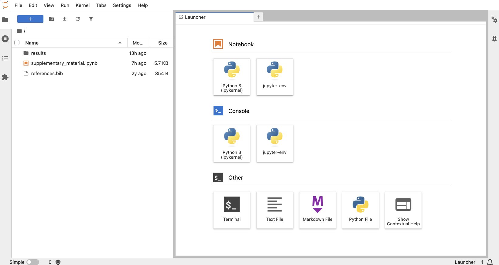

::: {.at-a-glance}
- **Time:** 40 minutes in class, then a lab on your own mini-analysis.
- **Slides:** [Jupyter](../lectures/06-jupyter/06-jupyter.qmd)
- **You need:** the `ltee-project` after [lesson 05](05-pixi.qmd): data downloaded, environments installed, on GitHub.
- **You will have:** `notebooks/explore-reads.ipynb`, which runs from top to bottom on a fresh kernel.
:::

## Overview

Jupyter notebooks are good for exploring: run a bit of code, look at the
result, try again. That freedom is also their weakness. You can run cells in
any order, delete a cell whose variables are still in memory, and save a
notebook whose outputs no longer match its code. In this lesson you explore
the LTEE reads in a notebook and learn to check that it runs from top to bottom
on a fresh kernel, without you. In [lesson 07](07-quarto.qmd) you turn what you
found into a Quarto report, which always runs that way.

### Learning outcomes

After this lesson you can:

1. **Start** JupyterLab with the project's environment and **explore** project data in a notebook.
2. **Run** a notebook from top to bottom on a fresh kernel from the command line, and save the result as HTML.
3. **Clear** a notebook's outputs before you share or commit it.
4. **Detect** a notebook that only works because of the order in which you ran its cells.

Checks: `jupyter nbconvert --execute` succeeds on your notebook (outcomes 1, 2), the
notebook file has no outputs (3), and the *Break it* notebook fails as predicted (4).

## 1. Start JupyterLab

From the project folder:

```{.bash .norun}
cd ~/cbio7501/ltee-project
pixi run jupyter lab
```

JupyterLab opens in your browser. (If it does not, copy the
`http://localhost:8888/lab?token=...` address from the terminal.) Because you
started it with `pixi run`, its Python kernel uses the project's environment:
the same Python, pandas and matplotlib that `pixi.lock` pins for everyone.

{.bordered fig-alt="JupyterLab with a file browser on the left and the launcher on the right, with buttons for a Python notebook, a console, a terminal and text files." width="90%"}

::: {.callout-note}
The terminal is now busy running Jupyter. Open a second terminal for other
commands, and stop Jupyter with `Ctrl-C` (twice) when you are done.
:::

## 2. Your first notebook

In JupyterLab's file browser, open the `notebooks/` folder, then **File →
New → Notebook** and choose the **Python 3 (ipykernel)** kernel. Rename it to
`explore-reads.ipynb` (right-click the tab → *Rename*).

A notebook is a list of **cells**. Markdown cells hold text; code cells hold
code and, after you run them (`Shift-Enter`), their output.

Type each block below into its own cell and run it.

**Cell 1 (Markdown):**

```{.markdown .norun}
# Exploring the LTEE reads

Questions: how long are the reads, and how does GC content vary between reads?
Exploration only: results that matter go into `reports/ltee-report.qmd`.
```

**Cell 2 (code): go to the project folder and load the samples.** The
notebook's kernel starts in `notebooks/`. To keep the rule that paths are
relative to the project folder, the first code cell moves there:

```{.python .norun}
# Run from the project folder, like the scripts (lesson 02).
import os
from pathlib import Path

if Path.cwd().name == "notebooks":
    os.chdir("..")

import matplotlib.pyplot as plt
import pandas as pd

samples = pd.read_csv("metadata/samples.tsv", sep="\t")
samples
```

The last expression of a cell (`samples`) is displayed as a table.

**Cell 3 (code): one row per read.**

```{.python .norun}
# One row per read: sample, read length and GC content (first 5,000 reads of read 1).
# A FASTQ file has four lines per read; the second one is the sequence.
rows = []
for _, s in samples.iterrows():
    with open(s["fastq_1"]) as fh:
        for i, line in enumerate(fh):
            if i == 4 * 5000:
                break
            if i % 4 == 1:
                seq = line.strip()
                gc = 100 * (seq.count("G") + seq.count("C")) / len(seq)
                rows.append({"sample": s["sample"], "length": len(seq), "gc": gc})
reads = pd.DataFrame(rows)
reads.groupby("sample")[["length", "gc"]].describe().round(1)
```

A loop in a cell is fine for exploring. When the report in
[lesson 07](07-quarto.qmd) needs the same numbers, this code moves into a
function in `scripts/`, where it can be reused and tested.

**Cell 4 (code): a histogram.** The `#|` lines are ignored by Jupyter but
used by Quarto when it renders the notebook ([lesson 07](07-quarto.qmd)), which adds the caption
and the alt text that Jupyter cannot add by itself:

```{.python .norun}
#| label: fig-lengths
#| fig-cap: "Read length after trimming, first 5,000 reads of read 1 of each sample."
#| fig-alt: "Histogram of read lengths from 25 to 150 bases. A single tall bar at 150 bases holds about 60 percent of the reads; the rest are spread thinly between 25 and 149 bases."
fig, ax = plt.subplots(figsize=(6, 3))
ax.hist(reads["length"], bins=50, color="#2a78d6")
ax.set_xlabel("Read length (bases)")
ax.set_ylabel("Reads")
plt.show()
```

**Cell 5 (Markdown): what you see.**

```{.markdown .norun}
About 60% of the reads are 150 bases long, the length of the sequencing run.
Trimming shortened the others, down to 25 bases, the shortest length that was kept.
```

**Cell 6 (code): a quick number.**

```{.python .norun}
# Share of reads shorter than 100 bases, per sample
(reads.assign(short=reads["length"] < 100)
      .groupby("sample")["short"].mean()
      .mul(100).round(1)
      .rename("% reads < 100 bases"))
```

```text
sample
SRR2584863    21.0
SRR2584866    21.8
SRR2589044    21.4
Name: % reads < 100 bases, dtype: float64
```

Save the notebook (`Ctrl-S` / `Cmd-S`).

::: {.callout-tip collapse="true" title="Fell behind? Copy the finished notebook"}
Save this as `notebooks/explore-reads.ipynb` (it is plain JSON; the outputs are empty):

```{.json filename="notebooks/explore-reads.ipynb" .write}
{
 "cells": [
  {
   "cell_type": "markdown",
   "id": "66ca769b",
   "metadata": {},
   "source": [
    "# Exploring the LTEE reads\n",
    "\n",
    "Questions: how long are the reads, and how does GC content vary between reads? Exploration only: results that matter go into `reports/ltee-report.qmd`."
   ]
  },
  {
   "cell_type": "code",
   "execution_count": null,
   "id": "6ee60c5f",
   "metadata": {},
   "outputs": [],
   "source": [
    "# Run from the project folder, like the scripts (lesson 02).\n",
    "import os\n",
    "from pathlib import Path\n",
    "\n",
    "if Path.cwd().name == \"notebooks\":\n",
    "    os.chdir(\"..\")\n",
    "\n",
    "import matplotlib.pyplot as plt\n",
    "import pandas as pd\n",
    "\n",
    "samples = pd.read_csv(\"metadata/samples.tsv\", sep=\"\\t\")\n",
    "samples"
   ]
  },
  {
   "cell_type": "code",
   "execution_count": null,
   "id": "4db95a94",
   "metadata": {},
   "outputs": [],
   "source": [
    "# One row per read: sample, read length and GC content (first 5,000 reads of read 1).\n",
    "# A FASTQ file has four lines per read; the second one is the sequence.\n",
    "rows = []\n",
    "for _, s in samples.iterrows():\n",
    "    with open(s[\"fastq_1\"]) as fh:\n",
    "        for i, line in enumerate(fh):\n",
    "            if i == 4 * 5000:\n",
    "                break\n",
    "            if i % 4 == 1:\n",
    "                seq = line.strip()\n",
    "                gc = 100 * (seq.count(\"G\") + seq.count(\"C\")) / len(seq)\n",
    "                rows.append({\"sample\": s[\"sample\"], \"length\": len(seq), \"gc\": gc})\n",
    "reads = pd.DataFrame(rows)\n",
    "reads.groupby(\"sample\")[[\"length\", \"gc\"]].describe().round(1)"
   ]
  },
  {
   "cell_type": "code",
   "execution_count": null,
   "id": "2f884626",
   "metadata": {},
   "outputs": [],
   "source": [
    "#| label: fig-lengths\n",
    "#| fig-cap: \"Read length after trimming, first 5,000 reads of read 1 of each sample.\"\n",
    "#| fig-alt: \"Histogram of read lengths from 25 to 150 bases. A single tall bar at 150 bases holds about 60 percent of the reads; the rest are spread thinly between 25 and 149 bases.\"\n",
    "fig, ax = plt.subplots(figsize=(6, 3))\n",
    "ax.hist(reads[\"length\"], bins=50, color=\"#2a78d6\")\n",
    "ax.set_xlabel(\"Read length (bases)\")\n",
    "ax.set_ylabel(\"Reads\")\n",
    "plt.show()"
   ]
  },
  {
   "cell_type": "markdown",
   "id": "4f891436",
   "metadata": {},
   "source": [
    "About 60% of the reads are 150 bases long, the length of the sequencing run. Trimming shortened the others, down to 25 bases, the shortest length that was kept."
   ]
  },
  {
   "cell_type": "code",
   "execution_count": null,
   "id": "8007f1f0",
   "metadata": {},
   "outputs": [],
   "source": [
    "# Share of reads shorter than 100 bases, per sample\n",
    "(reads.assign(short=reads[\"length\"] < 100)\n",
    "      .groupby(\"sample\")[\"short\"].mean()\n",
    "      .mul(100).round(1)\n",
    "      .rename(\"% reads < 100 bases\"))"
   ]
  }
 ],
 "metadata": {
  "kernelspec": {
   "display_name": "Python 3 (ipykernel)",
   "language": "python",
   "name": "python3"
  },
  "language_info": {
   "name": "python"
  }
 },
 "nbformat": 4,
 "nbformat_minor": 5
}
```
:::

## 3. Does it run without you?

In JupyterLab, **Kernel → Restart Kernel and Run All Cells**. If every cell
runs without an error, the notebook does not depend on anything you did by
hand. Do this before you share any notebook.

The same check from the command line, with a fresh kernel and no clicking,
also writes an HTML copy of the result. In a second terminal:

```{.bash .run}
cd ~/cbio7501/ltee-project
pixi run jupyter nbconvert --execute --to html notebooks/explore-reads.ipynb
```

```text
[NbConvertApp] WARNING | Alternative text is missing on 1 image(s).
[NbConvertApp] Writing 305957 bytes to notebooks/explore-reads.html
```

Read the warning: the histogram has no alt text in plain Jupyter output.
Quarto reads the `#| fig-alt` line and fixes that ([lesson 07](07-quarto.qmd)).

## 4. Notebook, script or report?

A rule of thumb for this course: **explore** in a notebook,
move code you reuse into **`scripts/`**, and put results you report into the
**Quarto report**. Notebooks are fine to share as a record of exploration, as
long as they run from top to bottom.

## 5. Clear outputs before you share

When you save a notebook after running its cells, Jupyter stores the outputs
(tables, the histogram as an image) **inside** the `.ipynb` file. If you
copied the finished notebook, it has no outputs yet: run it and save them, as
JupyterLab would:

```{.bash .run}
pixi run jupyter nbconvert --execute --to notebook --inplace notebooks/explore-reads.ipynb
```

Look at the file size:

```{.bash .run}
ls -l notebooks/explore-reads.ipynb
```

Outputs make the file large, turn `git diff` ([lesson
04](04-git.qmd)) into pages of encoded images, and can be out of date with the
code. Clear them before you commit:

```{.bash .run}
pixi run jupyter nbconvert --clear-output --inplace notebooks/explore-reads.ipynb
ls -l notebooks/explore-reads.ipynb
rm -f notebooks/explore-reads.html
```

In JupyterLab: **Edit → Clear Outputs of All Cells**, then save.

Now commit the notebook, without outputs, on a branch, and open a pull request:

```{.bash .run-ci}
git switch -c lesson-06-jupyter
git add notebooks/explore-reads.ipynb
git commit -m "Explore read lengths and GC content in a notebook"
git push -u origin lesson-06-jupyter
git switch main
git merge lesson-06-jupyter
git push
```

Clear the outputs before every later commit too. If `git status` lists the
notebook as modified although you only ran it, the change is saved outputs.
[nbdime](https://nbdime.readthedocs.io/) shows readable diffs of notebooks.

## Break it: cells run out of order

Create a notebook in JupyterLab with these three cells, **in this order**:

```{.python .norun}
lengths = [150, 98, 150, 25]
```

```{.python .norun}
print(sum(length >= min_length for length in lengths), "of", len(lengths), "reads kept")
```

```{.python .norun}
min_length = 100
```

Now run cell 1, then cell 3, then cell 2. It works: `2 of 4 reads kept`.
Save the notebook as `notebooks/out-of-order.ipynb`. Everything looks fine.

::: {.callout-tip collapse="true" title="Or copy the notebook"}
```{.json filename="notebooks/out-of-order.ipynb" .write}
{
 "cells": [
  {"cell_type": "code", "execution_count": 1, "id": "a1", "metadata": {}, "outputs": [],
   "source": ["lengths = [150, 98, 150, 25]"]},
  {"cell_type": "code", "execution_count": 3, "id": "a2", "metadata": {},
   "outputs": [{"name": "stdout", "output_type": "stream", "text": ["2 of 4 reads kept\n"]}],
   "source": ["print(sum(length >= min_length for length in lengths), \"of\", len(lengths), \"reads kept\")"]},
  {"cell_type": "code", "execution_count": 2, "id": "a3", "metadata": {}, "outputs": [],
   "source": ["min_length = 100"]}
 ],
 "metadata": {"kernelspec": {"display_name": "Python 3 (ipykernel)", "language": "python", "name": "python3"},
              "language_info": {"name": "python"}},
 "nbformat": 4, "nbformat_minor": 5
}
```
:::

Look at the execution counts in the saved notebook: `[1]`, `[3]`, `[2]`. That
is the clue. Now let a fresh kernel run it from top to bottom. Predict first:

```{.bash .expect-fail}
pixi run jupyter nbconvert --execute --to html notebooks/out-of-order.ipynb
```

```text
NameError: name 'min_length' is not defined
```

The saved notebook *shows* the output `2 of 4 reads kept`, but it cannot
produce it. Anyone who reruns it gets an error. Fix it by moving the
`min_length` cell above the cell that uses it, check again with
`nbconvert --execute`, then delete the notebook:

```{.bash .run}
rm -f notebooks/out-of-order.ipynb notebooks/out-of-order.html
```

## Troubleshooting

| Problem | What to do |
|---------|------------|
| `jupyter: command not found` | Start it with `pixi run jupyter lab` from the project folder. |
| JupyterLab opens but the browser shows nothing | Copy the full `http://localhost:8888/lab?token=...` link from the terminal. In WSL2, open it in your Windows browser. |
| `FileNotFoundError: ... 'metadata/samples.tsv'` | The first code cell did not move to the project folder: check that it runs `os.chdir("..")` and that the notebook is in `notebooks/`. |
| `No module named 'pandas'` in JupyterLab | The notebook uses a kernel from another Python. Choose **Kernel → Change Kernel → Python 3 (ipykernel)** and make sure you started Jupyter with `pixi run`. |
| `Port 8888 is already in use` | Another Jupyter is running; Jupyter picks the next port automatically. Use the link it prints. |
| The notebook file is several MB | It contains outputs: clear them (step 5). |

## Apply it to your own mini-analysis

Explore your own data in `notebooks/` of your capstone project: load it, look
at its size and a few summaries, make one quick plot. Then run it with
`jupyter nbconvert --execute` and clear its outputs. Note what you want to
keep: in [lesson 07](07-quarto.qmd), results go into a Quarto report and code
you reuse into `scripts/`.

## Key points

- Start JupyterLab with `pixi run jupyter lab`, so notebooks use the project's environment.
- Explore in notebooks; move reusable code into `scripts/` and reported results into a Quarto report.
- "Restart and run all" (or `nbconvert --execute`) is the test that a notebook does not depend on your clicks.
- Clear outputs before sharing or committing a notebook.
- Execution counts out of order (`[1] [3] [2]`) are a warning sign.

## Further reading

- Cheat sheet: [Jupyter](../cheatsheets/jupyter.qmd), with links to the official cheat sheets and references.
- JupyterLab documentation: <https://jupyterlab.readthedocs.io/>
- nbdime, diffs and merges for notebooks: <https://nbdime.readthedocs.io/>
- NBIS, *Working with Jupyter* (magics, widgets, nbdime for notebook diffs, nbval for testing notebooks): <https://nbisweden.github.io/workshop-reproducible-research/pages/jupyter.html>
- Quarto with Jupyter notebooks: <https://quarto.org/docs/tools/jupyter-lab.html>
- Rule A, Birmingham A, Zuniga C, et al. (2019). Ten simple rules for writing and sharing computational analyses in Jupyter Notebooks. *PLoS Comput Biol* 15:e1007007. <https://doi.org/10.1371/journal.pcbi.1007007>
