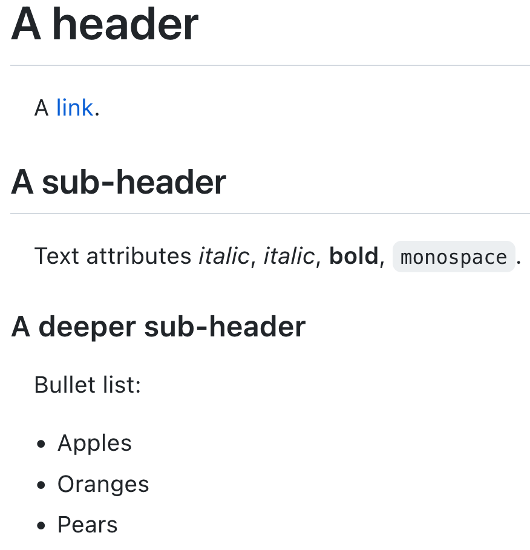

::: {.at-a-glance}
- **Time:** 15 minutes; come back whenever you need it.
- **Used in:** README files ([02](02-project-organization.qmd), [11](11-documentation.qmd)), Quarto reports ([07](07-quarto.qmd)), Jupyter notebooks ([06](06-jupyter.qmd)).
:::

## What Markdown is

Markdown is a way to format plain text so that it stays easy to read as text
and can also be turned into HTML, PDF or slides. GitHub shows `README.md`
files as formatted pages; Quarto and Jupyter use Markdown for all their text.
This whole course is written in Markdown.

:::: {.columns}
::: {.column width="50%"}
````{.markdown}
# A header

A [link](http://example.com).

## A sub-header

Text attributes _italic_, *italic*,
**bold**, `monospace`.

### A deeper sub-header

Bullet list:

  - Apples
  - Oranges
  - Pears
````
:::
::: {.column width="5%"}
:::
::: {.column width="45%"}
{.bordered fig-alt="The rendered example: a large header, a link, a sub-header, a line with italic, bold and monospace text, a smaller sub-header, and a bullet list of apples, oranges and pears."}
:::
::::

## The basics

````{.markdown}
# Heading 1
## Heading 2
### Heading 3

Plain text. A blank line starts a new paragraph.

*italic* or _italic_, **bold**, `inline code`, ~~struck through~~

- a bullet
- another bullet
  - indented two spaces: a sub-bullet

1. numbered
2. list

[a link](https://quarto.org) and a bare URL: <https://quarto.org>


> A quotation.

```bash
pixi run reproduce
```
````

Some rules that save time:

- Leave a **blank line** before lists, code blocks, tables and headings.
- A line break inside a paragraph is ignored; use a blank line for a new paragraph.
- Use **one `#` heading** per document (the title); start sections at `##`.
- Always write **alt text** for images: describe what the image shows, not
  just "figure".
- Give code blocks a language (`bash`, `python`, `yaml`) for colours and copy buttons.

## Tables

```{.markdown}
| Sample     | Generation | Variants |
|------------|-----------:|---------:|
| SRR2589044 |      5,000 |       10 |
| SRR2584866 |     50,000 |      775 |
```

The colons in the second line align columns (`---:` right, `:---:` centre).
For tables made from data, let code make them (lesson 07): typed tables go
out of date.

## What Quarto adds

```{.markdown}
::: {.callout-note}
A box that draws attention. Also callout-tip, -warning, -important.
:::

See @fig-quality and @tbl-reads.        <!-- cross-references to labelled cells -->

As shown by @tenaillon2016.             <!-- citation from references.bib -->

The mean is `{python} round(mean, 1)`.  <!-- inline code, computed at render -->
```

Cross-references need labels that start with `fig-` or `tbl-`; citations need
a `bibliography:` in the document header ([lesson 07](07-quarto.qmd)).

## Check your Markdown

Turn a small file into HTML to see what readers will see. Quarto uses
[Pandoc](https://pandoc.org/) to read Markdown; running Pandoc directly is the
quickest check:

```{.markdown filename="markdown-test.md" .write}
# Test

Some *italic* and **bold** text, and a list:

- one
- two

| a | b |
|---|---|
| 1 | 2 |
```

```{.bash .run}
pixi exec pandoc markdown-test.md -o markdown-test.html
cat markdown-test.html
```

## The blank line before a list

Remove the blank line before the list and render again: the list becomes
part of the paragraph. Most "Markdown does not work" problems are a missing
blank line. (GitHub's Markdown is more forgiving here, so a README can look
fine on GitHub and break when Quarto renders it: always leave the blank line.)

```{.markdown filename="markdown-test.md" .write}
# Test
Some text, then a list without a blank line before it:
- one
- two
```

```{.bash .run}
pixi exec pandoc markdown-test.md -o markdown-test.html
grep -c "<li>" markdown-test.html || echo "no list items: the list became plain text"
rm -f markdown-test.md markdown-test.html
```

## Further reading

- Cheat sheet: [Markdown](../cheatsheets/markdown.qmd), with links to the official cheat sheets and references.
- Markdown Guide: <https://www.markdownguide.org/>
- Quarto, *Markdown basics*: <https://quarto.org/docs/authoring/markdown-basics.html>
- GitHub, *Basic writing and formatting syntax*: <https://docs.github.com/en/get-started/writing-on-github/getting-started-with-writing-and-formatting-on-github/basic-writing-and-formatting-syntax>
