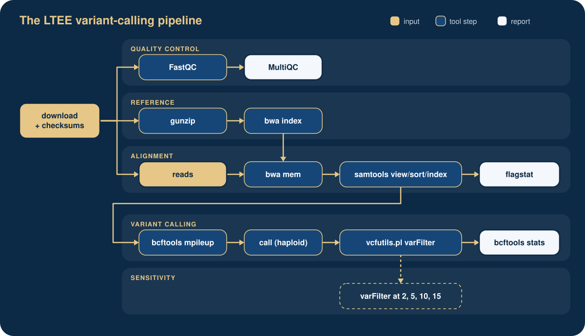

## The experiment

In 1988 Richard Lenski started twelve populations of *Escherichia coli* from
the same ancestor and has propagated them ever since, freezing samples every
500 generations: the **Long-Term Evolution Experiment** (LTEE). We use three
clones of population **Ara-3**, sequenced by Tenaillon et al. (2016) and
prepared for teaching by Data Carpentry:

| Run | Clone | Generation | Notes |
|-----|-------|-----------:|-------|
| SRR2589044 | REL2181A | 5,000 | |
| SRR2584863 | REL7179B | 15,000 | |
| SRR2584866 | REL11365 | 50,000 | hypermutator; can use citrate |

The reads are a trimmed subset (175,000 pairs per sample, 115 MB to
download, CC0) from figshare, <https://doi.org/10.6084/m9.figshare.7726454>;
the reference is *E. coli* B str. REL606 (GenBank CP000819.1).

## The question

*How many mutations did the clones accumulate over 50,000 generations, and is
the answer robust to how strictly we filter the variant calls?* The pipeline
is a tool for that question, not a recipe: the report compares four depth
thresholds and records a decision.

## The pipeline

{#fig-ltee-pipeline fig-alt="Flow chart of the LTEE variant-calling pipeline from downloaded data to filtered variants."}

The steps and options are those of the Data Carpentry *Wrangling Genomics*
variant-calling episode, with FastQC and MultiQC added. On a normal laptop the
whole pipeline takes under a minute.

**Expected results** (filtered variants, minimum depth 2): SRR2589044 10,
SRR2584863 25, SRR2584866 775. The Data Carpentry lesson reports 10, 25 and
766 with the tool versions of 2018.

## Which lesson adds what

| Lesson | What the project gains |
|--------|------------------------|
| [02](02-project-organization.qmd) | the project, generated from the template |
| [03](03-data-management.qmd#hands-on) | raw data, sources, checksums, sample sheet, download script |
| [04](04-git.qmd) | Git history, GitHub, pull requests, the lock file |
| [05](05-pixi.qmd) | the environments and tasks: download, QC and variant calling (shell script); the *Reproduce* Action reruns them |
| [06](06-jupyter.qmd), [07](07-quarto.qmd) | an exploration notebook, then the Quarto report (data part, also in `reproduce`) |
| [08](08-containers.qmd) | a Docker image built from `pixi.lock` |
| [09](09-snakemake.qmd), [10](10-nextflow.qmd) | Snakemake and Nextflow workflows, the variants section of the report |
| [11](11-documentation.qmd), [12](12-putting-it-together.qmd) | README, license, citation; release with a DOI |

## Handing it in

Your own `ltee-project` counts for **40%** of the course grade. When you have
finished lesson 12, hand in the address of its GitHub repository and the
Zenodo DOI of its release. [LTEE project](../assessment/ltee-project.qmd)
lists what the repository should show and how it is checked. Your capstone,
on your own research project, is assessed separately
([capstone rubric](../assessment/capstone-rubric.qmd), 30%).

## The finished project

A complete copy of the project, as it looks after lesson 12, is in the course
repository under
[`tutorials/ltee-project/`](https://github.com/khan-lab/cbio7501-f26/tree/main/tutorials/ltee-project).
Use it to catch up, or to compare with your own. Run it with:

```{.bash .norun}
cd tutorials/ltee-project
pixi run reproduce             # download, Snakemake, report
pixi run compare-workflows     # Snakemake and Nextflow agree
```

## Citations

- Tenaillon O, Barrick JE, Ribeck N, et al. (2016). Tempo and mode of genome evolution in a 50,000-generation experiment. *Nature* 536:165–170. <https://doi.org/10.1038/nature18959>
- Data Carpentry, *Wrangling Genomics*: <https://datacarpentry.github.io/wrangling-genomics/>
- Data Carpentry Genomics Curriculum Example Data, figshare: <https://doi.org/10.6084/m9.figshare.7726454>
